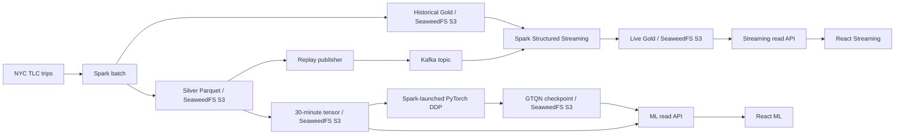

# UrbanFlow Release Readiness - 2026-09-25

## Decision

**Research demo: usable locally. Customer production release: NO-GO.**

The two React workspaces, their read APIs, and the saved data can be inspected.
This does not mean that a current taxi feed is running or that GTQN is a good
forecast model. Do not advertise live city coverage or automatic dispatch.

## What was checked

| Area | Observed result | Meaning |
| --- | --- | --- |
| Stored Streaming Gold | 2,863 rows at `s3a://urbanflow/gold/live_zone_metrics/task6/stream_health_20260920_001/` | A bounded February 2023 replay exists. |
| Streaming integration | Prior 10,000-event run: 2,863 reference rows, 2,863 Gold rows, zero mismatches | That run passed its bounded integration check. It is not a running service. |
| Spark Master | Two workers, zero active applications at audit time | `UrbanFlowLiveMetrics` is stopped. Kafka being online does not imply active processing. |
| Kafka | Four-partition `urbanflow.trip-events` topic exists | The broker/topic are available. Current consumer lag is not measured. |
| ML training | GTQN-Lite full run, two DDP ranks on two hosts, matching weight checksums | Distributed gradient synchronization was demonstrated. It does not prove model quality. |
| GTQN test | February 2023, 356,160 observed zone-bucket targets: WAPE 69.12%, MAE 5.61 trips | Large forecast error. WAPE is not classification accuracy. |
| Weekly reference | Same test period, 336-bucket lag: WAPE 24.28%, MAE 1.97 trips; 356,160 observed pairs | This simple rule is much better than the current GTQN run. This is diagnostic, not the frozen eight-model benchmark. |
| ML interval | P10-P90 coverage 90.15%, mean width 32.50 trips | Broad intervals cover many values; no calibration claim. |
| Test provenance | Legacy GTQN test report has no dataset fingerprint or exact key manifest | Same target count and evaluator code path are visible, but exact report provenance is not proven. |
| Browser | React Streaming and ML views tested at desktop and mobile widths | Navigation, manual refresh, error states, map resource loading, and visible layout checked. |

## Data and storage



The ML tensor and checkpoints are under
`s3a://urbanflow/dev/ml/runs/gtqn-20260917-001/`. Compose uses **Docker
named volumes**, including `seaweed-data` and `kafka-data`. On this machine,
Docker Desktop's backing file was observed at
`C:\Users\DELL\AppData\Local\Docker\wsl\disk\docker_data.vhdx` (about 38.7 GB),
not on drive D. Moving it needs a verified backup and a stopped Docker Desktop;
this audit did not move or delete it.

## Release blockers

1. **No current stream:** start and supervise a real `UrbanFlowLiveMetrics`
   job and a suitable producer; add measured progress, invalid-event counts,
   and Kafka lag. A replay snapshot cannot be labelled live.
2. **ML quality NO-GO:** GTQN loses badly to the weekly reference. Complete
   validation-only model selection, Spark MLlib GBT and other baselines, and
   calibration. Since the February test was already viewed, use a new untouched
   holdout for any tuned model. Do not tune against February and call it final.
3. **Source gaps:** October and December 2022 coverage is incomplete. Verify
   source completeness and create a clean data run before a real-world claim.
4. **Deployment controls:** add authenticated access, production builds and
   hosting, monitoring/alerts, backup/restore tests, and a rollback procedure.
5. **Storage placement:** move Docker's data disk to D using Docker Desktop's
   supported settings after backup. Verify the new location and S3 round-trip.

## Local review

From the repository root, after Docker Desktop is running:

```powershell
docker compose up -d seaweedfs spark-master spark-worker-1 spark-worker-2 streaming-api ml-api
cd urbanflow-ui
npm ci --cache D:\UrbanFlow-npm-cache
npm run dev
```

Open `http://127.0.0.1:5173/streaming` and `http://127.0.0.1:5173/ml`.
These are local research views. Data is read on entry or after manual Refresh;
there is no automatic timer. `streaming-api` and `ml-api` bind to localhost.
