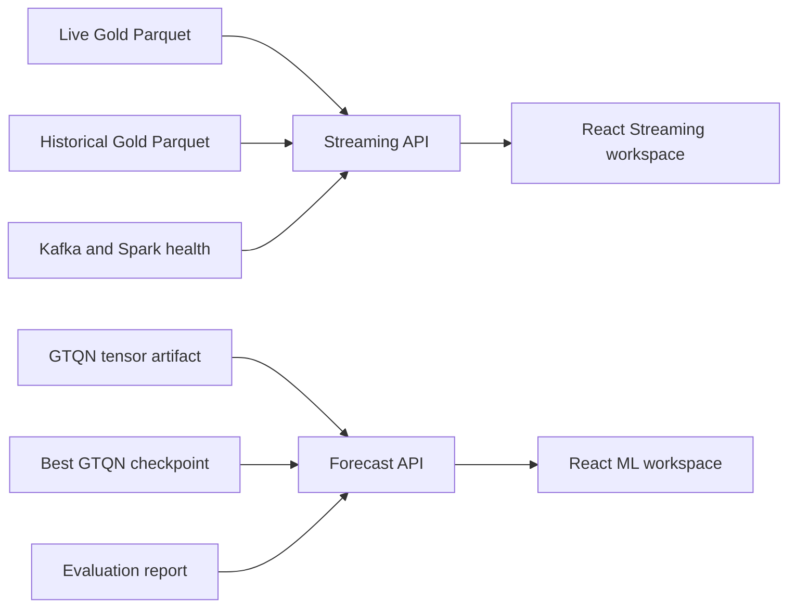

# UrbanFlow Two-Viewpoint User Interfaces

## Purpose

UrbanFlow needs two focused user interfaces on top of its existing data and
model work:

1. a Streaming UI for present-time taxi activity and pipeline reliability;
2. an ML UI for next-30-minute taxi-demand forecasts and their evidence.

Each interface has exactly two viewpoints. A viewpoint is a user role, not a
new data source or a cosmetic tab. Selecting it changes the information
hierarchy, available controls, and question being answered.

The project must remain honest about the GTQN model. It is a supervised,
spatiotemporal demand forecasting model, not a general chatbot or image model.

## Goals

- Give a dispatcher a fast, map-first answer about where taxi demand is high.
- Give a pipeline operator evidence that streaming data is fresh and correct.
- Give a planner a simple question-to-forecast experience.
- Give a teacher or evaluator the model evidence needed to judge reliability.
- Reuse contract-compliant Live Gold, Historical Gold, trained GTQN artifacts,
  and the existing zone GeoJSON.
- Work without paid SaaS, a proprietary map token, or a hosted LLM.
- Be testable with fixture data, API tests, and browser-level Playwright tests.

## Non-Goals

- Do not add ETL logic to either UI.
- Do not modify Foundation schemas, paths, timestamps, topics, or ownership.
- Do not claim a production city-wide forecast before the held-out test is run.
- Do not accept arbitrary images as an input to GTQN. There is no training data
  or model component that makes image understanding scientifically valid.
- Do not build a general conversational agent or RAG system.

## Architecture

`FastAPI` is the thin serving boundary. It validates requests and returns
typed, JSON-safe results. It does not transform Silver data or run training.
React renders two distinct workspaces, Streaming and ML, each with two
role-specific viewpoints. The existing Streamlit app remains a legacy
diagnostic during migration but is not the primary experience.

The selected libraries are open source and fit the current Python project:

- FastAPI: typed, high-performance Python API with a mature ecosystem.
- React and Vite: predictable client state and a buildable local frontend.
- Ant Design: compact operational controls and tables.
- MapLibre GL JS: open-source interactive map without a proprietary token.
- Apache ECharts: responsive charts with controlled labels and axes.

No package is selected because of popularity alone. The UI migration is driven
by observed Streamlit layout failures, rerenders, and the need for stable
role-specific workflows. A hosted LLM or image classifier would not produce
a valid answer from this taxi dataset. Historical replay must show its actual
2023 window and never present itself as live 2026 data. Fetch data on page
entry or explicit Refresh, not automatic polling; cached data retains its
timestamp and source label.

## Streaming UI

### Dispatcher Viewpoint

Question: "Where is live pickup demand unusual right now?"

- Full operational map of the latest Live Gold window.
- Clear high-demand and below-baseline zone colors.
- Top-zone list, current trips, historical mean, demand ratio, and window time.
- Zone selector and latest-window comparison for investigation; historical
  exploration is added only with a bounded time-query API.
- No infrastructure jargon in the primary surface.

### Reliability Viewpoint

Question: "Can I trust the live view right now?"

- Latest successful output window and its age.
- Live Gold row count and number of high-demand rows.
- Kafka topic partition/consumer lag summary when available.
- Spark query progress, latest batch duration, invalid records, checkpoint path,
  and clear degraded/unavailable states.
- The UI distinguishes missing telemetry from a healthy zero value.

## ML UI

### Planner Viewpoint

Question: "How busy will pickup Zone Z be at time T?"

- Explicit zone and date/time controls are the primary input. A natural-language
  question is optional and must not imply chatbot or image understanding.
- Response contains P50 forecast, P10-P90 interval, demand category, selected
  zone/time, model run identifier, and a short uncertainty explanation.
- Invalid, ambiguous, out-of-range, and unavailable-model requests produce
  actionable messages rather than fabricated answers.

### Evidence Viewpoint

Question: "What proves this forecast model is useful and what are its limits?"

- Current model/version and artifact fingerprint.
- Held-out metrics with their exact evaluation stage: the existing raw February
  report is preliminary because same-key baselines, checkpoint reselection,
  and calibration required by `plan.md` are not complete.
- Seasonal-naive and Spark MLlib GBT comparisons on identical test keys.
- Interval coverage, calibration status, and a compact anomaly-candidate table.
- Data-coverage limitations and an explicit status when final evaluation is not
  yet available.

## Serving Contracts

The new APIs are application-local and versioned under `/v1`.

| Endpoint | Consumer | Source | Contract |
| --- | --- | --- | --- |
| `GET /v1/streaming/overview` | Dispatcher | Live and Historical Gold | Read-only summary |
| `GET /v1/streaming/health` | Reliability | Spark/Kafka telemetry + Gold freshness | Read-only status |
| `GET /v1/streaming/zones` | Dispatcher | Taxi-zone GeoJSON | Static map geometry |
| `POST /v1/forecast` | Planner | GTQN checkpoint + tensor artifact | `{zone_id, forecast_at}` -> quantiles |
| `GET /v1/forecast/evidence` | Evidence | final evaluation artifact | Read-only metrics/status |

All timestamp input and output use explicit timezone information. The UI shows
`America/New_York` clocks. The API rejects naive timestamps instead of using
the host timezone.

## Forecast Safety

- The API loads a checkpoint only when its dataset fingerprint and config hash
  match the tensor artifact.
- Requests outside the tensor-supported date range are rejected in V1.
- Forecasts are not re-labelled as classification accuracy.
- The response returns three ordered quantiles: `p10 <= p50 <= p90`.
- A natural-language parser may fill controls, but structured controls remain
  the source of truth before the model is called.

## Error and Empty States

| Situation | Required behavior |
| --- | --- |
| No Live Gold output | Explain that the stream has not produced a window. |
| Gold schema mismatch | Fail visibly; never silently drop columns. |
| Stale Live Gold | Show last-update age and degraded status. |
| Incomplete ML benchmark | Show raw test metrics as preliminary; withhold final-quality claims. |
| Missing checkpoint/artifact | Disable prediction and show the failed dependency. |
| Ambiguous question | Ask the user to select zone/time; do not guess. |
| Unsupported image upload | Do not expose it in V1. |

## Verification and Audit

### API and data

- Unit tests validate request models, timezone rejection, and quantile order.
- Fixture-based tests validate empty, stale, malformed, and normal Gold data.
- Forecast tests use a small deterministic GTQN fixture checkpoint.
- Contract tests ensure no UI/serving code imports Batch or Replay source.

### Browser

- Playwright runs both viewpoints at desktop and mobile widths.
- Screenshots are inspected for visible maps/charts, clipped controls, text
  overflow, unreadable contrast, and role-specific content.
- A test verifies that switching viewpoint changes the primary content.
- A test verifies planner validation messages and reliable error states.

### Operational

- `docker compose config --quiet` passes after Compose changes.
- Existing Streaming end-to-end verification remains PASS.
- The ML inference API is exercised against the final trained checkpoint only
  after its held-out evaluation writes an evidence artifact.

## Delivery Sequence

1. Finish and evaluate the current distributed GTQN training run.
2. Add the application-local FastAPI serving boundary with fixtures/tests.
3. Build a React Streaming workspace with two viewpoints, preserving the Streamlit diagnostic.
4. Build a React ML workspace with planner/evidence viewpoints.
5. Audit API, contracts, and browser behavior with Playwright before human
   review.

## Acceptance Criteria

- Exactly two selectable viewpoints exist in each UI.
- Streaming Dispatcher and Reliability screens read only operational outputs.
- ML Planner returns a valid forecast only from a verified model artifact.
- ML Evidence does not claim final metrics before test evaluation exists.
- Unsupported images cannot be mistaken for supported model input.
- Both UIs render without overlap, clipping, or empty visualizations at desktop
  and mobile sizes.
- All relevant automated tests and existing streaming verification pass.
