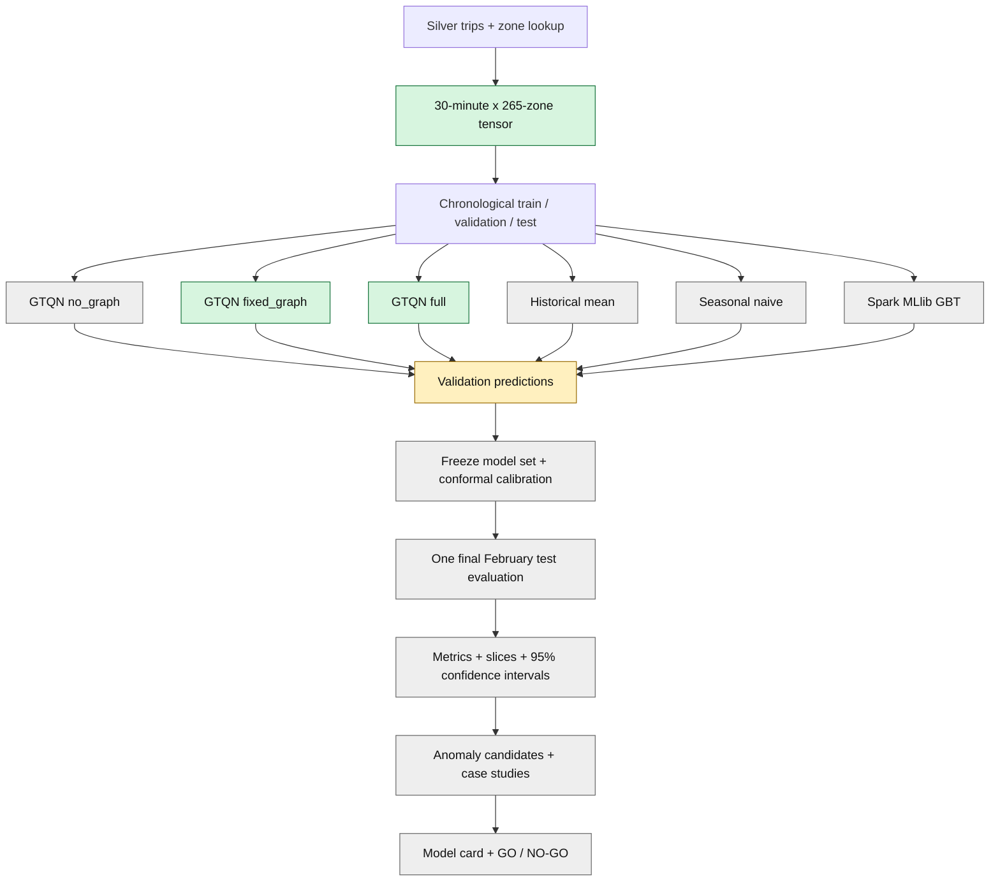

# UrbanFlow ML Quality, Benchmark, and Demonstration Implementation Plan

> **For agentic workers:** REQUIRED SUB-SKILL: Use `superpowers:subagent-driven-development` (recommended) or `superpowers:executing-plans` to implement this plan task-by-task. Steps use checkbox (`- [ ]`) syntax for tracking.

**Goal:** Produce an honest, reproducible answer to whether UrbanFlow's distributed GTQN-Lite model predicts next-30-minute NYC taxi demand better than strong baselines, whether its uncertainty is calibrated, and whether it can surface useful anomaly candidates.

**Architecture:** Spark remains the distributed data and classical-ML engine. PyTorch DDP through Spark `TorchDistributor` trains the spatio-temporal neural model on two executor hosts. A frozen evaluation layer compares every model on the same chronological rows, adds validation-only conformal calibration, computes block-bootstrap confidence intervals, and publishes one auditable report instead of calling a loss value "accuracy".

**Tech Stack:** Apache Spark/PySpark 4.2.0, Spark MLlib, Spark `TorchDistributor`, PyTorch DDP, Python 3.11+, NumPy, PyArrow, Parquet, SeaweedFS S3A, Docker Compose, pytest.

**Spec:** `docs/superpowers/specs/2026-09-17-distributed-spatiotemporal-forecast-design.md`

## Global Constraints

- Foundation 1.0.0 is frozen. ML outputs remain experimental under `s3a://urbanflow/dev/ml/`.
- Canonical input is `s3a://urbanflow/silver/trips/`; timezone is exactly `America/New_York`.
- Run ID for the current experiment is exactly `gtqn-20260917-001`.
- Train is `2022-08-08..2022-12-31`, validation is January 2023, and test is February 2023.
- Test is read once by the frozen final benchmark. No hyperparameter, threshold, epoch, calibration value, or model choice may change after test metrics are viewed.
- The graph, scaler, feature statistics, and MASE denominator use training data only.
- Models are compared on the same observed target mask and exact `(forecast_window_start, pickup_zone_id)` keys.
- Generated tensors, predictions, checkpoints, Parquet, and Spark logs stay in SeaweedFS or ignored output directories, not Git.
- Docker storage and large host data stay on drive D because drive C is capacity constrained.
- Every long command is resumable or immutable; a host shutdown must not silently restart training from epoch 1.
- New behavior follows test-first RED-GREEN-REFACTOR. Tests and evidence cannot be weakened to obtain PASS.
- Missing October and December 2022 data must remain visible. Current-data results are not publication-ready results.

## Review Focus

- Empty or all-zero evaluation slices must return explicit undefined metrics, not divide by zero or a fake zero score; Task 1 owns this test.
- A prediction row with a missing/duplicate key must make the benchmark fail before scoring; Task 5 owns this test.
- Validation-only conformal calibration must never read a February target; Task 4 owns this test.
- Day-block bootstrap must resample complete days, preserving within-day temporal and cross-zone dependence; Task 6 owns this test.
- Anomaly rows must map flattened tensors back to the correct timestamp and zone and must never be described as proven incidents; Task 7 owns this test.

---

## 1. Current Truth: 2026-09-19

Training completion is not project completion.

| Area | Evidence now | Status |
|---|---|---|
| Tensor artifact | Validated compact `[time, 265 zones]` artifact and train-only graph/scaler | DONE |
| Full GTQN-Lite | Early-stopped at epoch 10; best validation pinball loss `0.0733497` at epoch 2 | DONE: training only |
| Fixed-graph GTQN-Lite | Early-stopped at epoch 10; best validation pinball loss `0.0797862` at epoch 2 | DONE: training only |
| Distributed proof | 2 ranks on `spark-worker-1` and `spark-worker-2`; equal checksums; Spark evidence PASS | DONE for full/fixed |
| No-graph ablation | No durable final run evidence | NOT DONE |
| Point-only ablation | Required by the design spec to test quantile-head value; no implementation/run evidence | NOT DONE |
| Neural test evaluator | Local code exists; focused unit tests passed; no durable evaluation artifact exists | WORK IN PROGRESS |
| Historical/seasonal baselines | Functions and unit tests exist | CODE ONLY |
| Spark MLlib GBT | Training code and tests exist | FULL FAIR BENCHMARK NOT RUN |
| Test metrics | No verified `test_metrics.json`, comparison table, or confidence interval | NOT DONE |
| Calibration | No validation-only conformal artifact | NOT DONE |
| Anomaly demonstration | Candidate function exists; no timestamped/zone-mapped output or review | NOT DONE |
| Final model card / decision | No quality report and no GO/NO-GO decision | NOT DONE |

**Honest answer now:** there is no final accuracy percentage. `0.0733497` is validation quantile loss in scaled space; it is neither `7.3% accuracy` nor `92.7% accuracy`.

Uncommitted evaluator work already present and must be continued, not discarded:

```text
urbanflow-ml/forecasting/probabilistic_evaluation.py
urbanflow-ml/forecasting/scaling.py
urbanflow-ml/tests/test_probabilistic_evaluation.py
urbanflow-ml/tests/test_scaling.py
urbanflow-ml/spark/evaluate_gtqn_test.py
```

The unrelated untracked directory `urbanflow-streaming/docs/plans/` is outside this plan and must not be changed.

## 2. What The Model Actually Delivers

### Primary job

For each of 265 NYC taxi zones, predict the number of pickups in the next 30-minute bucket.

```text
Input:  previous 336 half-hour buckets (7 days)
        + calendar features
        + fixed OD-flow zone graph
        + learned adaptive zone graph

Output: P10, P50, P90 pickup-demand forecasts for every zone
```

- `P50` is the central demand forecast.
- `P10..P90` is an 80% prediction interval after calibration.
- An actual value outside this interval is an anomaly **candidate**, not proof of an incident.

### Model type and why

GTQN-Lite is a small **spatio-temporal graph neural network**, not a language model and not a Transformer.

- Temporal gated dilated convolutions learn short, daily, and weekly demand patterns.
- A fixed OD graph represents observed travel relations between zones.
- Adaptive embeddings learn additional directed zone relations.
- A quantile head predicts uncertainty and enforces `P10 <= P50 <= P90`.
- DDP synchronizes gradients across two Spark executor processes.

This design is related to Graph WaveNet and DCRNN, but kept small enough for the available CPU cluster. A large Transformer would add compute and presentation value without a justified data advantage here.

### Practical and social value

The useful outputs are narrow and testable:

1. **Demand positioning:** identify zones likely to have high pickup demand in the next 30 minutes.
2. **Unusual-demand monitoring:** flag zone-time observations far outside a calibrated expected range for human investigation.

The project must not claim reduced waiting time, traffic, fuel use, emissions, or improved public safety without separate operational outcome data.

## 3. Workflow and Progress Diagram



```text
Current position: validation/evaluation implementation
Training: full and fixed_graph complete
Project: not complete because the benchmark and decision layers do not exist yet
```

## 4. Metrics: What Each Number Means

There is no classification accuracy because the target is a count, not a class.

| Metric | Meaning | Better | Role |
|---|---|---:|---|
| MAE | Average absolute error in trips per zone per 30 minutes | Lower | Human-readable primary scale |
| RMSE | Penalizes large misses more strongly | Lower | Peak-risk sensitivity |
| WAPE | Total absolute error / total actual demand | Lower | Primary global comparison |
| MASE | Test MAE / train seasonal-naive error scale | `< 1` | Whether model beats a weekly-naive scale |
| Signed bias | Net over/under prediction / total actual demand | Near `0` | Systematic bias |
| Top-10 zone recall | Fraction of actual top-demand zones found in predicted top 10 | Higher | Operational positioning |
| Pinball P10/P50/P90 | Quantile forecast error | Lower | Probabilistic quality |
| P10-P90 coverage | Fraction of actuals inside interval | Near `0.80` | Calibration |
| Mean interval width | Average uncertainty range in trips | Lower at equal coverage | Sharpness |

Interpretation example: `WAPE = 0.30` means total absolute forecast error equals 30% of total observed demand. The report must say exactly that; it must not rename this as "70% accuracy."

All metrics are reported globally and by:

- zone and borough;
- actual-demand decile;
- peak/off-peak;
- weekday/weekend;
- day, so confidence intervals can preserve temporal dependence.

## 5. Mandatory Benchmark

Every row below must use the same test keys and observed mask.

| Model | Purpose |
|---|---|
| Historical mean | Simple same-zone, weekday, half-hour reference |
| Persistence | Previous 30-minute demand; catches easy short-term continuity |
| Seasonal naive | Same zone and same slot one week earlier; strongest simple time baseline |
| Spark MLlib GBT | Classical distributed nonlinear baseline |
| GTQN no_graph | Tests whether graph information adds value |
| GTQN point_only | Same graph family with a P50-only head; tests whether quantile training adds value |
| GTQN fixed_graph | Tests fixed OD relations without adaptive graph |
| GTQN full | Tests fixed + adaptive graph together |

The benchmark is fair only when:

- train rows fit parameters;
- validation rows select parameters, epoch, calibration, and thresholds;
- February test rows are used by one frozen final command;
- GBT is not refit on train+validation unless all trainable models are refit under the same rule;
- no model silently receives extra rows or a different missing-value mask.

The design spec selects neural checkpoints by validation WAPE, with validation pinball loss as tie-breaker. Existing `best.pt` files were selected by validation quantile loss. Before test is opened, every durable epoch checkpoint must therefore be rescored on January data in original trip units. `selection.json` must name the lowest-WAPE epoch; if the complete epoch set needed for an honest comparison is unavailable, that variant is retrained under a new run ID before finalization.

## 6. Decision Rules

### Technical gates

| Gate | Exact PASS condition |
|---|---|
| DATA-GO | 265-zone schema; exact split dates; no NaN/Inf; incomplete months visible |
| DISTRIBUTION-GO | 2 ranks, 2 hosts, positive batches, equal final checksum, successful Spark executor evidence |
| EVALUATION-GO | all eight model rows have identical test keys and finite applicable metrics; test manifest hash recorded |
| CALIBRATION-GO | full-model P10-P90 coverage is `0.76..0.84`; interval width is reported |
| QUALITY-GO | full GTQN has MASE `< 1`, at least 5% lower WAPE than both seasonal naive and GBT, and paired day-block 95% CI upper bound for both WAPE deltas is `< 0` |
| REPRO-GO | config hash, Git SHA, data fingerprint, seed, versions, model/checkpoint hash, command, runtime, and paths exist |

### Final decision

- **GO:** every technical gate passes. Recommend GTQN full for a controlled pilot, not city-wide deployment.
- **RESEARCH PASS / DEPLOYMENT NO-GO:** pipeline and distributed evidence pass, but full GTQN does not beat baselines or calibration fails. Publish the negative result and recommend the best baseline.
- **INVALID:** data/key leakage, unequal evaluation rows, missing artifact, or test reuse is detected. Repair and create a new run ID; do not reinterpret the old result.
- **CURRENT-DATA ONLY:** even with QUALITY-GO, incomplete October/December data prevents a publication-ready claim.

## 7. Artifact Contract

Final immutable root:

```text
s3a://urbanflow/dev/ml/runs/gtqn-20260917-001/evaluation-v1/
```

Required outputs:

```text
manifest.json
validation/predictions/<model>/part-*.parquet
calibration/full.json
test/predictions/<model>/part-*.parquet
test/metrics/model_comparison.json
test/metrics/model_comparison.parquet
test/metrics/slices.parquet
test/metrics/bootstrap_intervals.json
test/anomalies/candidates.parquet
test/anomalies/case_studies.json
decision.json
```

Prediction schema:

```text
forecast_window_start timestamp  # America/New_York bucket identity
pickup_zone_id       integer
actual               double
p10                  double      # nullable for point-only baselines
p50                  double
p90                  double      # nullable for point-only baselines
observed              boolean
model_name            string
split                 string      # validation or test
run_id                string
```

## 8. File Map

| File | Responsibility |
|---|---|
| `urbanflow-ml/forecasting/probabilistic_evaluation.py` | Point/probabilistic metrics and anomaly score primitives |
| `urbanflow-ml/forecasting/scaling.py` | Correct inverse scaling for count and quantile tensors |
| `urbanflow-ml/forecasting/prediction_records.py` | Tensor-index to timestamp/zone records and schema validation |
| `urbanflow-ml/forecasting/calibration.py` | Validation-only conformal quantile calibration |
| `urbanflow-ml/forecasting/benchmark.py` | Key alignment, MASE, grouped metrics, model comparison |
| `urbanflow-ml/forecasting/statistical_tests.py` | Paired day-block bootstrap confidence intervals |
| `urbanflow-ml/spark/export_gtqn_predictions.py` | Load checkpoint and write validation/test neural predictions |
| `urbanflow-ml/spark/run_baseline_benchmark.py` | Historical, persistence, seasonal, and train-only GBT predictions |
| `urbanflow-ml/spark/finalize_benchmark.py` | Frozen one-shot test comparison and decision artifacts |
| `urbanflow-ml/spark/build_anomaly_report.py` | Candidate Parquet and case-study JSON |
| `urbanflow-ml/tests/` | Unit/contract tests for every module above |
| `urbanflow-ml/docs/results/quality-report.md` | Final numbers and interpretation |
| `urbanflow-ml/docs/results/model-card.md` | Intended use, limits, ethics, data caveats |
| `STATUS.md` | Whole-project measured status and recovery commands |
| `urbanflow-ml/README.md` | Operator commands and metric explanations |

---

## Task 1: Finish Metric Primitives and Export Validation Predictions

**Files:**
- Modify: `urbanflow-ml/forecasting/probabilistic_evaluation.py`
- Modify: `urbanflow-ml/forecasting/scaling.py`
- Create: `urbanflow-ml/forecasting/prediction_records.py`
- Replace untracked WIP with: `urbanflow-ml/spark/export_gtqn_predictions.py`
- Modify: `urbanflow-ml/tests/test_probabilistic_evaluation.py`
- Modify: `urbanflow-ml/tests/test_scaling.py`
- Create: `urbanflow-ml/tests/test_prediction_records.py`

**Interfaces:**
- Consumes: tensor arrays, metadata, durable epoch checkpoints, variant, split.
- Produces: `prediction_rows(...) -> pyarrow.Table`; `regression_metrics(...) -> dict[str, float | None]`; immutable validation Parquet.

- [ ] Add a failing test proving zero-demand WAPE and bias are `None`, not NaN/Inf, and empty arrays raise `ValueError("evaluation slice is empty")`.
- [ ] Add a failing test mapping tensor indices `[t0, t1]` and zone IDs `[1, 2]` to exactly four timestamped rows with ordered keys.
- [ ] Run `python -m pytest -q urbanflow-ml/tests/test_probabilistic_evaluation.py urbanflow-ml/tests/test_scaling.py urbanflow-ml/tests/test_prediction_records.py`; expect the new tests to fail.
- [ ] Implement explicit empty/zero handling and `prediction_rows` with this signature:

```python
def prediction_rows(
    *, timestamps: np.ndarray, zone_ids: np.ndarray, target_indices: np.ndarray,
    actual: np.ndarray, predictions: np.ndarray, observed: np.ndarray,
    model_name: str, split: str, run_id: str,
) -> pa.Table:
    """Return one unique row per target timestamp and zone in canonical order."""
```

- [ ] Refactor the evaluator into `export_gtqn_predictions.py --run-id gtqn-20260917-001 --variant {no_graph,point_only,fixed_graph,full} --split {validation,test}`; it must verify config hash and dataset fingerprint before inference.
- [ ] For each neural variant, evaluate every durable epoch on validation in original trip units, select lowest WAPE with pinball loss as tie-breaker, and write immutable `selection.json`; do not assume the existing quantile-loss `best.pt` is the final checkpoint.
- [ ] Make `--split test` require `--frozen-manifest s3a://urbanflow/dev/ml/runs/gtqn-20260917-001/evaluation-v1/manifest.json`; validation export does not require it.
- [ ] Run the focused tests again; expect all PASS.
- [ ] Run validation export for `full` and `fixed_graph`; read each Parquet back and verify unique keys, 265 rows per bucket, ordered quantiles, finite values, and the expected data fingerprint.
- [ ] Write `validation/export-proof.json` containing row counts, min/max timestamps, key hash, model/checkpoint hash, and `status: PASS`.
- [ ] Commit only Task 1 files with `git commit -m "feat(ml): export auditable GTQN predictions"`.

## Task 2: Complete the Missing Distributed Ablations

**Files:**
- Modify only if a defect is proven: `urbanflow-ml/spark/train_gtqn_distributed.py`
- Modify only if a defect is proven: `urbanflow-ml/forecasting/distributed.py`
- Modify: `urbanflow-ml/forecasting/gtqn.py`
- Modify: `urbanflow-ml/forecasting/trainer.py`
- Modify: `urbanflow-ml/tests/test_gtqn.py`
- Test: `urbanflow-ml/tests/test_distributed_contract.py`
- Evidence: `urbanflow-ml/docs/results/distributed-training.md`

**Interfaces:**
- Consumes: existing tensor fingerprint and current GTQN configuration with `variant=no_graph` or `variant=point_only`.
- Produces: checkpoint histories, two-rank evidence, and validation predictions for both ablations.

- [ ] Add a failing model test proving `point_only` emits shape `[batch, zone, 1]`, finite values, and receives gradients through the same temporal/graph backbone.
- [ ] Implement a P50-only head trained with MAE while preserving the same graph, capacity, optimizer, seed, data rows, and DDP contract as full GTQN.
- [ ] Run the distributed contract tests before launch; expect PASS.
- [ ] Start `no_graph` and `point_only` with the same seed, hidden size, lookback, batch policy, maximum epochs, and early-stopping patience as full/fixed; select their final checkpoints by validation WAPE.
- [ ] Resume from a matching durable checkpoint when present; refuse any checkpoint whose config hash or tensor fingerprint differs.
- [ ] Verify `world_size=2`, distinct hosts, positive per-rank batch counts, equal checksums, no failed Spark stage, and durable best checkpoint.
- [ ] Export no-graph and point-only validation predictions through Task 1 and verify the same validation key hash as full/fixed.
- [ ] Record actual epochs, best validation metric, elapsed time, hosts, checksums, and Spark event-log path in `distributed-training.md`.
- [ ] Commit with `git commit -m "feat(ml): complete distributed forecast ablations"`.

## Task 3: Produce Fair Baseline Validation Predictions

**Files:**
- Modify: `urbanflow-ml/forecasting/baselines.py`
- Modify: `urbanflow-ml/spark/train_demand_forecast.py`
- Create: `urbanflow-ml/spark/run_baseline_benchmark.py`
- Modify: `urbanflow-ml/tests/test_evaluation.py`
- Modify: `urbanflow-ml/tests/test_model.py`

**Interfaces:**
- Consumes: canonical demand frame and chronological split config.
- Produces: canonical validation predictions for `historical_mean`, `persistence`, `seasonal_naive`, and `mllib_gbt`; selected GBT parameters frozen in the manifest.

- [ ] Add a failing test proving persistence uses only the immediately previous bucket and seasonal naive uses exactly 336 buckets earlier.
- [ ] Add a failing test proving historical mean and GBT fit rows end on `2022-12-31` and never include validation rows.
- [ ] Add a failing test proving all four baseline outputs conform to the prediction schema and key hash from Task 1.
- [ ] Run the focused tests; expect the new tests to fail.
- [ ] Implement baseline prediction columns and change final GBT fitting to training rows only after validation selects hyperparameters.
- [ ] Run tests again; expect PASS.
- [ ] Run validation baseline export, read every output back, compare key hashes, and store GBT selected parameters and model hash.
- [ ] Commit with `git commit -m "feat(ml): add fair demand forecast baselines"`.

## Task 4: Calibrate Quantile Intervals Using Validation Only

**Files:**
- Create: `urbanflow-ml/forecasting/calibration.py`
- Create: `urbanflow-ml/tests/test_calibration.py`

**Interfaces:**
- Consumes: full-model validation rows only.
- Produces: `ConformalCalibration(alpha=0.2, qhat=...)` and calibrated P10/P90.

- [ ] Add a failing hand-calculated test for conformity scores `max(p10-y, y-p90, 0)` and finite-sample quantile index `ceil((n+1)*(1-alpha))`.
- [ ] Add a failing test that rejects any input containing `split != "validation"`.
- [ ] Add a failing test proving calibrated intervals remain ordered and never become narrower.
- [ ] Run `python -m pytest -q urbanflow-ml/tests/test_calibration.py`; expect FAIL.
- [ ] Implement:

```python
@dataclass(frozen=True)
class ConformalCalibration:
    alpha: float
    qhat: float

def fit_conformal(rows: pa.Table, *, alpha: float = 0.2) -> ConformalCalibration: ...
def apply_conformal(rows: pa.Table, calibration: ConformalCalibration) -> pa.Table: ...
```

- [ ] Run the tests; expect PASS.
- [ ] Fit once on full-model January predictions; save `calibration/full.json` with validation key hash, checkpoint hash, alpha, qhat, sample count, created time, and code Git SHA.
- [ ] Commit with `git commit -m "feat(ml): add validation-only conformal calibration"`.

## Task 5: Freeze the Experiment and Run One Final Test Evaluation

**Files:**
- Create: `urbanflow-ml/forecasting/benchmark.py`
- Create: `urbanflow-ml/tests/test_benchmark.py`
- Create: `urbanflow-ml/spark/finalize_benchmark.py`
- Modify: `urbanflow-ml/config/settings.example.yaml`

**Interfaces:**
- Consumes: eight frozen model definitions, selected checkpoints/GBT params, calibration JSON, data fingerprint.
- Produces: immutable manifest, aligned test predictions, comparison JSON/Parquet, decision-input metrics.

- [ ] Add a failing test that rejects duplicate keys, missing keys, different observed masks, a changed dataset fingerprint, or a model list other than the eight mandatory models.
- [ ] Add a failing test for MASE where the denominator is training-only mean `abs(y_t-y_{t-336})` over observed pairs.
- [ ] Add a failing test proving `WAPE=0.30` remains `0.30` and is never emitted as an accuracy field.
- [ ] Run `python -m pytest -q urbanflow-ml/tests/test_benchmark.py`; expect FAIL.
- [ ] Implement canonical key alignment, MAE/RMSE/WAPE/MASE/bias/top-10 recall, pinball/coverage/width, and no `accuracy` output field.
- [ ] Write `manifest.json` before test inference with exact model hashes, selected parameters, calibration hash, data fingerprint, expected split boundaries, seed, package versions, and `frozen: true`.
- [ ] Make `finalize_benchmark.py` refuse an existing evaluation root unless `--resume` finds byte-identical manifest hashes and complete PASS markers.
- [ ] Run the full unit suite before opening test: `python -m pytest -q urbanflow-ml/tests`; expect PASS.
- [ ] Run the final Spark command once. It exports all eight February predictions, validates identical keys, applies the frozen calibration, writes comparison artifacts, and reads them back.
- [ ] Verify expected February bucket count, 265 zone rows per bucket, no duplicate keys, finite metrics, and no failed Spark stage.
- [ ] Commit code and concise evidence with `git commit -m "feat(ml): finalize frozen forecast benchmark"`.

## Task 6: Add Slices and Statistical Confidence

**Files:**
- Create: `urbanflow-ml/forecasting/statistical_tests.py`
- Create: `urbanflow-ml/tests/test_statistical_tests.py`
- Modify: `urbanflow-ml/spark/finalize_benchmark.py`

**Interfaces:**
- Consumes: aligned test predictions and daily metric contributions.
- Produces: grouped metrics and paired 95% confidence intervals for model-minus-baseline deltas.

- [ ] Add a failing deterministic test where 20 synthetic days are resampled as whole blocks and all 265 zone rows from a selected day remain together.
- [ ] Add a failing test where a uniformly better model has a negative WAPE-delta confidence interval and identical models contain zero.
- [ ] Run focused tests; expect FAIL.
- [ ] Implement `paired_day_block_bootstrap(..., n_resamples=2000, seed=20260917)` and percentile 95% intervals.
- [ ] Add slices for borough, demand decile, peak/off-peak, weekday/weekend, and per-zone error distribution.
- [ ] Compare full GTQN against seasonal naive and GBT using paired daily WAPE contributions.
- [ ] Run tests; expect PASS.
- [ ] Regenerate only derived metrics from immutable test predictions; do not rerun or tune models.
- [ ] Write and read back `slices.parquet` and `bootstrap_intervals.json`.
- [ ] Commit with `git commit -m "feat(ml): quantify benchmark uncertainty and slices"`.

## Task 7: Build an Honest Anomaly-Candidate Demonstration

**Files:**
- Modify: `urbanflow-ml/forecasting/probabilistic_evaluation.py`
- Create: `urbanflow-ml/spark/build_anomaly_report.py`
- Modify: `urbanflow-ml/tests/test_probabilistic_evaluation.py`
- Create: `urbanflow-ml/tests/test_anomaly_report.py`

**Interfaces:**
- Consumes: calibrated full-model test prediction rows.
- Produces: timestamped candidate Parquet and a fixed top-20 case-study JSON.

- [ ] Add a failing test mapping high/low interval breaches to exact timestamp and zone IDs.
- [ ] Add a failing test that severity is `breach / max(interval_width, 1e-6)` and candidates are sorted by severity, timestamp, then zone.
- [ ] Add a failing test that output metadata contains `claim_level: candidate_not_incident`.
- [ ] Run focused tests; expect FAIL.
- [ ] Implement candidate columns: timestamp, zone, actual, P10/P50/P90, residual, direction, interval width, normalized severity, borough, and demand decile.
- [ ] Write all candidates to Parquet and the top 10 high plus top 10 low breaches to case-study JSON.
- [ ] Manually inspect the 20 rows for impossible counts, missing zone names, DST/timezone mistakes, and sparse-data artifacts; record exclusions without deleting valid negative evidence.
- [ ] Do not report anomaly precision/recall because no incident labels exist.
- [ ] Commit with `git commit -m "feat(ml): publish calibrated anomaly candidates"`.

## Task 8: Publish the Model Card, Quality Report, and Operator Guide

**Files:**
- Create: `urbanflow-ml/docs/results/quality-report.md`
- Create: `urbanflow-ml/docs/results/model-card.md`
- Modify: `urbanflow-ml/docs/results/distributed-training.md`
- Modify: `urbanflow-ml/README.md`
- Modify: `STATUS.md`
- Modify: `plan.md`

**Interfaces:**
- Consumes: read-back verified artifacts from Tasks 1-7.
- Produces: one human-readable conclusion traceable to exact machine-readable evidence.

- [ ] Generate a comparison table with all eight models and every applicable metric; bold the best value only after checking metric direction.
- [ ] State the best model in plain language, its MAE in trips, WAPE interpretation, MASE relation to seasonal naive, top-10 recall, coverage, interval width, and 95% confidence intervals.
- [ ] Include separate sections for global results, weak slices, anomaly examples, distributed proof, compute/runtime, failure cases, and October/December limitations.
- [ ] Apply the exact GO/NO-GO rules from Section 6 without changing thresholds after seeing results.
- [ ] Explain that a negative result is still a valid master-level finding; recommend GBT or seasonal naive if either wins.
- [ ] Add exact start/resume/status/log commands to README and STATUS, including S3 paths and Docker service names.
- [ ] Mark each task checkbox only when its evidence file has been read back successfully.
- [ ] Commit with `git commit -m "docs(ml): publish benchmark and model decision"`.

## Task 9: Final Independent Verification

**Files:**
- Verify only; fix a file only when a concrete defect is reproduced.

**Interfaces:**
- Consumes: committed code and immutable evaluation artifacts.
- Produces: final verification record and branch-ready decision.

- [ ] Run `docker compose config --quiet`; expect exit code 0.
- [ ] Run `docker compose run --rm foundation-check`; expect `FOUNDATION FIXTURES = PASS`.
- [ ] Run the complete ML tests in the project container; record test count and duration.
- [ ] Read every required `evaluation-v1` artifact from SeaweedFS and verify its hash against `manifest.json`.
- [ ] Verify no test timestamp appears in training, graph, scaler, GBT fitting, conformal fitting, or model-selection metadata.
- [ ] Verify all eight prediction key hashes are equal and all comparison metrics can be recomputed from Parquet.
- [ ] Verify full/fixed/no-graph DDP evidence independently: world size, hosts, batches, checksum, Spark event log.
- [ ] Verify `git status --short` contains no generated data, checkpoint, secret, `.env`, or unrelated staged file.
- [ ] Request an independent code/research review focused on leakage, metric correctness, statistical claims, and reproducibility.
- [ ] Apply verified review fixes, rerun the affected checks, and record the final commit SHA in `STATUS.md`.

## 9. Operator Commands and Tracking

These are the stable entry points the implementation must provide:

```powershell
# Unit status
python -m pytest -q urbanflow-ml/tests

# Container health
docker compose ps

# Live Spark job log
docker logs -f $(docker ps --filter "name=urbanflow-spark-submit" --format "{{.Names}}")

# SeaweedFS evidence inventory
docker compose run --rm aws s3 ls s3://urbanflow/dev/ml/runs/gtqn-20260917-001/ --recursive
```

Progress is tracked in three places, each with a different job:

```text
plan.md       = task checkboxes and acceptance rules
STATUS.md     = latest measured state, exact run commands, restart instructions
SeaweedFS     = durable machine-readable evidence and large artifacts
```

Estimated remaining compute on the current 2-worker CPU setup:

| Work | Rough wall time |
|---|---:|
| Validation exports + checks | 0.5-1.5 hours |
| No-graph + point-only DDP runs | 2-6 hours, early stopping dependent |
| Four baselines including GBT | 1-3 hours |
| Frozen test inference + metrics | 1-2 hours |
| Bootstrap, anomaly output, reports | 1-3 hours |
| Total | about 5.5-15.5 hours, excluding data repair |

These are estimates, not promises. The plan records actual runtimes after each stage.

## 10. Definition of Done

The project is complete only when all statements below are true:

- Eight models/baselines are evaluated on identical February keys.
- MAE, RMSE, WAPE, MASE, signed bias, top-10 recall, pinball loss, coverage, and interval width are published where applicable.
- Paired day-block 95% confidence intervals accompany claims that one model is better.
- Anomaly output is mapped to real timestamps/zones and described only as candidates.
- The final decision follows the frozen thresholds and may honestly be NO-GO.
- All outputs are reproducible from one manifest and exact commands.
- Incomplete October/December data is clearly disclosed.
- A restart after shutdown resumes durable stages without silently retraining from scratch.
- Tests, Docker checks, Foundation validation, artifact read-back, and independent review pass.

## 11. Scientific Basis

- Graph WaveNet motivates dilated temporal convolution plus adaptive graph learning: <https://arxiv.org/abs/1906.00121>
- DCRNN supports graph-based spatio-temporal forecasting for traffic systems: <https://arxiv.org/abs/1707.01926>
- Adaptive Conformal Inference motivates calibrated intervals under time-series distribution shift: <https://arxiv.org/abs/2202.07282>
- Forecast evaluation guidance supports multiple error measures, strong naive baselines, and careful interpretation: <https://pmc.ncbi.nlm.nih.gov/articles/PMC9718476/>

The novelty claim is not "we used a complex neural network." The defensible research contribution is the controlled comparison of graph choices, calibrated uncertainty, distribution evidence, slice robustness, and an honest negative-result path on a real Big Data pipeline.
