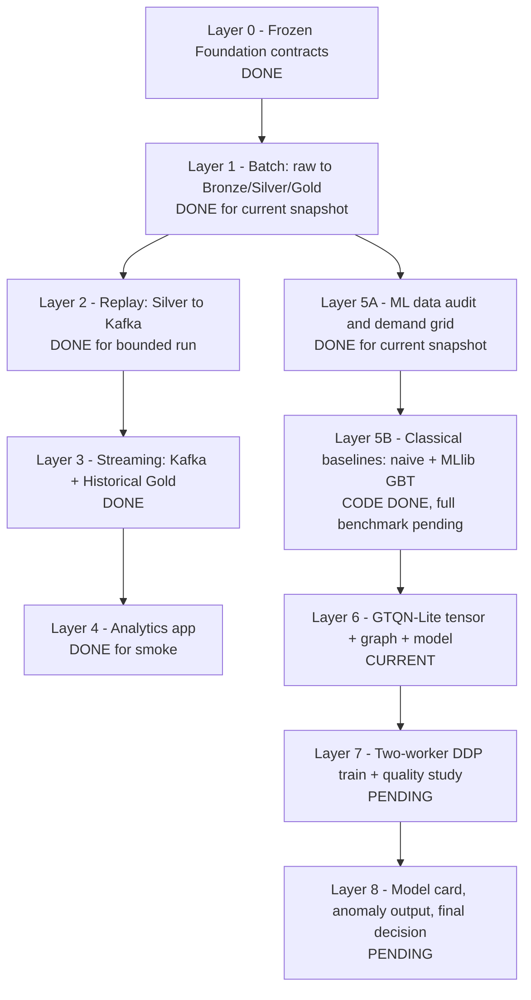

# UrbanFlow Distributed Spatio-Temporal Forecast Implementation Plan

> **For agentic workers:** REQUIRED SUB-SKILL: Use `superpowers:subagent-driven-development` (recommended) or `superpowers:executing-plans` to implement this plan task-by-task. Steps use checkbox (`- [ ]`) syntax for tracking.

**Goal:** Build, train, and evaluate a master-level 2026 distributed model that predicts next-30-minute taxi demand for all NYC taxi zones and derives calibrated anomaly candidates.

**Architecture:** Spark builds a compact chronological zone-demand dataset and a training-only OD graph. Spark `TorchDistributor` launches two executor-side PyTorch DDP ranks to train GTQN-Lite, a gated temporal convolution plus fixed/adaptive graph fusion and a monotonic P10/P50/P90 head. Historical mean, seasonal naive, and Spark MLlib GBT remain mandatory baselines.

**Tech Stack:** Apache Spark/PySpark 4.2.0, Spark TorchDistributor, PyTorch DDP, Python 3.11+, NumPy, PyArrow, SeaweedFS S3A, Parquet, Docker Compose, pytest.

**Spec:** `docs/superpowers/specs/2026-09-17-distributed-spatiotemporal-forecast-design.md`

## Global Constraints

- Foundation 1.0.0 remains frozen.
- Canonical input is `s3a://urbanflow/silver/trips/` and experiment output stays under `s3a://urbanflow/dev/ml/`.
- Analytics and Spark session timezone is exactly `America/New_York`.
- Application projects share contracts and data, never source imports.
- Train/validation/test are chronological; February 2023 is never used for fitting or tuning.
- The zone graph and all scaling statistics use train data only.
- Every generated run path is immutable and carries config, Git SHA, seed, dataset fingerprint, dependency versions, and timing.
- Every long stage supports the same `run-id --resume`; epoch checkpoints are stored in SeaweedFS and validated against config hash plus dataset fingerprint.
- Large tensors, Parquet, checkpoints, predictions, and event logs stay out of Git and in Docker/SeaweedFS storage on drive D where possible.
- New behavior follows test-first RED-GREEN-REFACTOR.
- A stage is complete only when its command, measured output, and evidence file exist.

---

## 0. Workflow and Live Progress

### End-to-end layers



### Data and training flow

```text
TLC raw files on D:\
  -> Spark Batch
  -> SeaweedFS Silver (15,448,035 trip rows, ~0.316 GiB physical objects)
  -> zero-inclusive [time, 265 zones] demand matrix
  -> train-only OD graph + train-only robust scaler
  -> 7-day sliding windows, next 30-minute target
  -> Spark TorchDistributor
       -> rank 0: disjoint batches -> local gradient --+
       -> rank 1: disjoint batches -> local gradient --+--> DDP all-reduce
                                                         -> identical update
  -> P10/P50/P90 forecasts for every zone
  -> point quality + uncertainty calibration + anomaly candidates
  -> baseline/ablation comparison -> GO or NO-GO
```

### Progress table

| Layer | Deliverable | Current evidence | Status |
|---|---|---|---|
| 0 | Frozen schemas, paths, topic, timezone | Foundation fixture validator recorded in `STATUS.md` | DONE |
| 1 | Silver and Historical Gold | Silver audit: 15,448,035 rows; Historical Gold: 534,240 rows | DONE with Oct/Dec data caveat |
| 2 | Kafka replay | 10,000 sent, 0 rejected in bounded run | DONE |
| 3 | Live Gold | 4,394 expected = 4,394 actual, 0 mismatch | DONE |
| 4 | Analytics | Streamlit HTTP 200 and Gold-read smoke | DONE |
| 5A | ML demand grid/features | demand-frame and leakage tests | DONE |
| 5B | Naive + GBT baselines | 6 evaluation tests + 3 GBT tests | CODE DONE |
| 6 | Tensor artifact, graph, GTQN-Lite | tests and implementation required below | CURRENT |
| 7 | Two-worker DDP + comparison | rank proof, event logs, test metrics | PENDING |
| 8 | Model card and final decision | model card, anomaly sample, evidence refresh | PENDING |

### How the owner checks progress

```text
plan.md                         layer map and checkboxes
STATUS.md                       latest measured state and exact commands
urbanflow-ml/docs/results/      concise evidence per gate
s3a://urbanflow/dev/ml/runs/    immutable generated run artifacts
urbanflow-ml/output/            ignored local Spark event logs
```

Completion rule:

```text
DONE = test/command exit 0
     + expected invariant/metric is measured
     + output path is recorded
     + concise evidence is written
```

---

## 1. Research Decision and Alternatives

### Selected: GTQN-Lite

GTQN-Lite combines a shared gated temporal convolution, a fixed OD-flow graph,
a learned adaptive graph, and a monotonic quantile head. It directly matches
the data: taxi zones are graph nodes, demand is a time series, and operational
decisions need both a forecast and uncertainty.

Advantages:

- learns non-linear daily/weekly temporal behavior;
- learns hidden relations between zones beyond physical neighbors;
- gives P10/P50/P90 uncertainty, useful for anomaly candidates;
- small enough for CPU training and clear enough for ablation;
- DDP genuinely synchronizes gradients across Spark executors.

Disadvantages:

- more engineering and failure modes than MLlib GBT;
- two CPU workers demonstrate distribution but may not provide speedup;
- incomplete October/December data limits academic claims;
- learned graph edges require careful interpretation.

### Rejected as main model: full Transformer/TFT

A full Transformer is powerful for long multivariate sequences, but the current
dataset has only several thousand 30-minute timestamps and the Docker workers
are memory constrained. It would add parameter count and tuning cost without a
clear hypothesis that cannot be tested by a lighter temporal encoder.

### Rejected as main model: Spark MLlib GBT

GBT remains a strong, useful baseline. It is distributed classical ML, but it
does not explicitly learn a zone graph, sequence representation, or calibrated
prediction interval. It is insufficient as the sole master-level contribution.

---

## 2. Acceptance Gates

| Gate | Required evidence | Failure meaning |
|---|---|---|
| DATA-GO | schema, row/month counts, 265 zones, no silent invalid rows | source is not fit for experiment |
| TENSOR-GO | deterministic shape/order/fingerprint, no NaN/Inf, graph/scaler train-only | model input is not trustworthy |
| MODEL-GO | finite forward/backward, ordered quantiles, reload parity | neural implementation is incorrect |
| DISTRIBUTION-GO | world size 2, two executor hosts, non-empty rank work, equal checksums, Spark log proof | training is not proven distributed |
| QUALITY-GO | untouched-test baseline + ablation + calibration table | no evidence of useful model quality |
| REPRO-GO | immutable run, config/hash/SHA/seeds/versions/timing/paths | result cannot be repeated or audited |

QUALITY-GO decision:

```text
GO when full GTQN-Lite improves test WAPE over seasonal naive and GBT,
or when point accuracy is statistically tied but the P10-P90 interval is
well calibrated (coverage near 80%) and provides documented operational value.

NO-GO when it loses materially to a simpler baseline, fails calibration,
or distribution/reproducibility evidence is missing.
```

Current-data and publication-ready are separate labels. With only 63 October
and 82 December trips, a successful run is `CURRENT-DATA GO`, not
`PUBLICATION-READY GO`.

---

## 3. Implementation Tasks

### Task 1: Preserve and verify the current distributed GBT proof work

**Files:**
- Modify: `.gitignore`
- Modify: `urbanflow-ml/spark/train_demand_forecast.py`
- Create: `urbanflow-ml/tools/verify_spark_event_log.py`
- Create: `urbanflow-ml/tests/test_event_log_verifier.py`

**Interfaces:**
- Produces: `summarize_event_logs(paths) -> dict` with executor counts, failures, and PASS/FAIL.
- Produces: S3A-aware `path_exists(spark, path) -> bool`.

- [x] Write five event-log behavior tests for two executors, driver-only work, failed task, failed stage, and speculative duplicate.
- [x] Run the test before implementation and observe missing-module failure.
- [x] Implement event-log parsing and per-path Hadoop filesystem resolution.
- [x] Run focused tests: `5 passed`.
- [ ] Re-run focused tests immediately before the first new commit.
- [ ] Commit with `test(ml): verify distributed Spark execution evidence`.

### Task 2: Lock runtime dependencies and resource envelope

**Files:**
- Modify: `docker/spark-ml/Dockerfile`
- Modify: `compose.yaml`
- Modify: `urbanflow-ml/pyproject.toml`
- Create: `urbanflow-ml/tests/test_runtime_contract.py`

**Interfaces:**
- Produces: Spark image containing pinned PyTorch, NumPy, PyArrow, and PyYAML.
- Produces: two Spark workers with enough executor memory for CPU DDP.

- [x] Write a runtime test that imports `torch`, constructs a two-layer tensor operation, imports `TorchDistributor`, and prints exact versions.
- [x] Run in the current image and confirm failure because PyArrow/PyTorch are absent.
- [x] Pin PyTorch 2.8.0 CPU and PyArrow 21.0.0 in the Spark image.
- [x] Measure 15.73 GiB host RAM, 7.62 GiB Docker RAM, and set two 2 GiB one-core worker containers; generated Docker storage remains on D.
- [x] Build the image and run `docker compose config --quiet`.
- [x] Run the runtime test inside `spark-submit`: one test passes and exact versions are printed.
- [x] Commit with `build(ml): add reproducible PyTorch distributed runtime`.

### Task 3: Build the compact chronological tensor artifact

**Files:**
- Create: `urbanflow-ml/forecasting/tensor_data.py`
- Create: `urbanflow-ml/spark/build_tensor_dataset.py`
- Create: `urbanflow-ml/tests/test_tensor_data.py`
- Modify: `urbanflow-ml/config/settings.example.yaml`

**Interfaces:**
- Produces: `TensorDatasetMetadata` with timestamps, zone order, split indices, fingerprint, and data-quality flags.
- Produces: `build_training_arrays(demand_rows, zone_ids, split_config) -> dict[str, np.ndarray]`.
- Produces: immutable `.npz` plus JSON metadata for DDP ranks.

- [x] Write tests with hand-checked two-zone timestamps for deterministic zone order and matrix values.
- [x] Add tests proving a missing bucket becomes zero while its observed mask is false.
- [x] Add a test proving dataset fingerprint changes when counts or zone order changes.
- [x] Run focused tests and observe missing API failures.
- [x] Implement compact float32 counts, boolean mask, timestamps, calendar matrix, and split indices.
- [x] Implement Spark writer using the existing zero-inclusive demand frame.
- [x] Validate no NaN/Inf, non-negative counts, exactly 265 unique zones, monotonic timestamps, and non-empty splits.
- [x] Run local tests and full S3A artifact build/read-back verification for `gtqn-20260917-001`.
- [x] Commit with `feat(ml): build compact chronological tensor dataset`.

### Task 4: Build a leakage-safe OD graph and robust scaler

**Files:**
- Create: `urbanflow-ml/forecasting/graph.py`
- Create: `urbanflow-ml/forecasting/scaling.py`
- Create: `urbanflow-ml/tests/test_graph.py`
- Create: `urbanflow-ml/tests/test_scaling.py`
- Modify: `urbanflow-ml/spark/build_tensor_dataset.py`

**Interfaces:**
- Produces: `build_od_adjacency(trips, zone_ids, train_end) -> np.ndarray`.
- Produces: `RobustZoneScaler.fit(train_counts)`, `.transform()`, `.inverse_transform()`.

- [x] Write a directed three-zone fixture with literal expected row-normalized adjacency.
- [x] Write a test proving post-train trips do not affect adjacency.
- [x] Write scaler tests for zero-IQR sparse zones and round-trip inversion.
- [x] Run tests and observe missing API failures.
- [x] Implement Laplace-smoothed, row-normalized train-only OD adjacency with self loops.
- [x] Implement train-only `log1p` median/IQR scaling with safe scale 1.0 for zero IQR.
- [x] Store adjacency and scaler values in the tensor artifact and metadata.
- [x] Run nine focused tests and tensor read-back verification.
- [x] Commit with `feat(ml): add train-only zone graph and robust scaling`.

### Task 5: Implement sliding windows and deterministic distributed sampling

**Files:**
- Create: `urbanflow-ml/forecasting/dataset.py`
- Create: `urbanflow-ml/tests/test_dataset.py`

**Interfaces:**
- Produces: `ZoneDemandDataset(arrays, split, lookback=336)`.
- Produces: `(history, calendar, target, target_time_index)` tensors.

- [x] Write a small literal matrix test proving history ends at `t-1` and target is exactly `t`.
- [x] Test that train, validation, and test windows never cross their target boundaries.
- [x] Test deterministic rank-0/rank-1 sampler indices are disjoint and balanced for the epoch set.
- [x] Run focused tests and observe missing API failures.
- [x] Implement lazy slicing so windows are not materialized on disk.
- [x] Add sampler seeding by epoch and rank.
- [x] Run three focused tests in the pinned PyTorch image.
- [x] Commit with `feat(ml): add leakage-safe demand window dataset`.

### Task 6: Implement GTQN-Lite with monotonic quantiles

**Files:**
- Create: `urbanflow-ml/forecasting/gtqn.py`
- Create: `urbanflow-ml/tests/test_gtqn.py`

**Interfaces:**
- Produces: `GTQNConfig`.
- Produces: `GTQNLite.forward(history, calendar, fixed_adjacency) -> [batch, zone, 3]`.
- Produces: `pinball_loss(predictions, target, quantiles, weights) -> scalar`.

- [x] Write a shape test for batch 2, four zones, 16 history steps, and three quantiles.
- [x] Write a behavior test proving every output satisfies P10 <= P50 <= P90.
- [x] Write a finite backward test covering adaptive adjacency and graph gate parameters.
- [x] Write literal pinball-loss cases for under- and over-prediction.
- [x] Run tests and observe missing API failures.
- [x] Implement gated dilated temporal blocks with residual connections and dropout.
- [x] Implement directed adaptive adjacency and one fixed/adaptive diffusion fusion layer.
- [x] Implement monotonic quantile construction using positive softplus deltas.
- [x] Run five tests, including the real `[1, 265, 336, 2]` input shape, under the parameter budget.
- [x] Commit with `feat(ml): add graph temporal quantile network`.

### Task 7: Implement trainer, early stopping, checkpoint parity, and metrics

**Files:**
- Create: `urbanflow-ml/forecasting/trainer.py`
- Create: `urbanflow-ml/forecasting/probabilistic_evaluation.py`
- Create: `urbanflow-ml/tests/test_trainer.py`
- Create: `urbanflow-ml/tests/test_probabilistic_evaluation.py`

**Interfaces:**
- Produces: `train_epoch`, `evaluate_epoch`, `EarlyStopper`, and serializable `TrainingResult`.
- Produces: pinball, coverage, interval width, and interval-breach anomaly rows.

- [x] Write early-stopping tests for improvement, patience exhaustion, and best-state restoration.
- [x] Write checkpoint reload and dataset-fingerprint rejection tests with prediction equality within `1e-6`.
- [x] Write hand-calculated coverage, interval-width, and anomaly-severity tests.
- [x] Run focused tests and observe missing API failures.
- [x] Implement AdamW-compatible train loop, clipping at 1.0, scheduler state, best checkpoint restore, and full RNG state.
- [x] Implement P10-P90 coverage and interval-breach anomaly output.
- [x] Run six focused tests including real optimizer updates and evaluation batches.
- [x] Commit with `feat(ml): train and evaluate calibrated demand forecasts`.

### Task 8: Launch real two-worker DDP through Spark TorchDistributor

**Files:**
- Create: `urbanflow-ml/spark/train_gtqn_distributed.py`
- Create: `urbanflow-ml/forecasting/distributed.py`
- Create: `urbanflow-ml/tests/test_distributed_contract.py`
- Modify: `urbanflow-ml/config/settings.example.yaml`

**Interfaces:**
- Produces: `distributed_train(config, artifact_path) -> rank-0 TrainingResult`.
- Produces: rank evidence with world size, rank, host, batches, and final checksum.

- [ ] Write a two-process local Gloo contract test that gathers ranks and verifies equal post-update checksums.
- [ ] Run the test before implementation and observe missing API failure.
- [ ] Implement environment-driven DDP initialization and `DistributedSampler`.
- [ ] Gather hostname, batch count, and SHA-256 parameter checksum from every rank.
- [ ] Implement `TorchDistributor(num_processes=2, local_mode=False, use_gpu=False)` launcher.
- [ ] Save rank-0 checkpoint locally, then copy it and metadata into immutable S3A run paths.
- [ ] Run local two-process smoke; this does not pass DISTRIBUTION-GO.
- [ ] Start Spark master and both workers and run a two-epoch executor-side smoke.
- [ ] Verify event logs with `verify_spark_event_log.py` and require two non-driver executor IDs.
- [ ] Commit with `feat(ml): train GTQN with Spark orchestrated DDP`.

### Task 9: Run baselines and ablation study on identical splits

**Files:**
- Create: `urbanflow-ml/spark/evaluate_experiment.py`
- Create: `urbanflow-ml/forecasting/ablation.py`
- Create: `urbanflow-ml/tests/test_ablation.py`

**Interfaces:**
- Produces one comparison schema for historical mean, seasonal naive, GBT, no-graph, fixed-graph, and full GTQN-Lite.

- [ ] Write a test rejecting comparison rows with different dataset fingerprints or split boundaries.
- [ ] Write a decision-rule test for GO, uncertainty-value GO, and NO-GO.
- [ ] Run tests and observe missing API failures.
- [ ] Implement ablation flags that remove adaptive/fixed graph paths without changing data splits.
- [ ] Implement comparison table with WAPE, MAE, RMSE, bias, top-k recall, pinball, coverage, width, parameters, and runtime.
- [ ] Run full GBT baseline and three GTQN variants with the same immutable artifact.
- [ ] Evaluate February exactly once after validation choices are frozen.
- [ ] Commit with `test(ml): compare distributed model with honest baselines`.

### Task 10: Produce model card, anomaly sample, and evidence

**Files:**
- Create: `urbanflow-ml/docs/results/distributed-training.md`
- Create: `urbanflow-ml/docs/results/model-card.md`
- Create: `urbanflow-ml/docs/results/quality-report.md`
- Modify: `urbanflow-ml/README.md`
- Modify: `STATUS.md`
- Modify: `plan.md`

**Interfaces:**
- Produces: auditable final run paths, metrics, limitations, and GO/NO-GO decision.

- [ ] Record data sizes, month completeness, tensor shapes, model parameter count, ranks/hosts, epochs, wall time, and artifact paths.
- [ ] Record all baseline and ablation metrics, including unfavorable results.
- [ ] Export top anomaly candidates with interval breach direction and severity.
- [ ] State that anomaly candidates are not labeled incidents.
- [ ] Update every plan checkbox and layer status from fresh evidence.
- [ ] Run all Python, Spark, Compose, S3A, DDP, event-log, and artifact checks in Section 5.
- [ ] Commit with `docs(ml): record distributed forecast experiment evidence`.

---

## 4. Expected Runtime and Resource Branches

Runtime cannot be promised before the Docker CPU/RAM envelope and first epoch
are measured. The controller will estimate remaining time after the smoke run:

```text
ETA = measured median epoch seconds
    x remaining epochs
    x remaining ablation runs
    + GBT baseline time
    + evaluation/write overhead
```

Expected order on a normal laptop CPU:

| Work | Expected range |
|---|---:|
| image build/download | 10-45 minutes |
| tensor + graph artifact | 10-40 minutes |
| two-epoch DDP smoke | 5-20 minutes |
| one GTQN run with early stopping | 1-4 hours |
| three neural variants + GBT + evaluation | 4-12 hours |

These are planning ranges, not guarantees. The first measured epoch replaces
them. A multi-terabyte claim is not made: current Silver objects are about
0.316 GiB and 15.45 million rows. Distributed training is demonstrated by
execution topology and gradient synchronization, not by pretending the local
dataset is terabytes.

Failure branches:

```text
OOM -> batch 8 to 4 to 2 -> hidden 32 to 16 -> report capacity change
DDP hang -> inspect rank batch counts and Gloo rendezvous -> fail partial run
NaN -> stop -> preserve config/log -> test scaler/loss/gradient path
Slow epoch -> keep model hypothesis, reduce candidate runs, never use test to tune
GTQN loses -> publish NO-GO and select best baseline
Oct/Dec incomplete -> label result current-data, load months before publication claim
```

---

## 5. Final Verification Matrix

Run from repository root and save exact outputs in evidence files.

```powershell
docker compose config --quiet
docker compose run --rm foundation-check
```

```powershell
.\urbanflow-streaming\.venv\Scripts\python.exe -m pytest -q urbanflow-ml\tests
```

```powershell
docker compose --profile integration run --rm spark-submit `
  --master local[2] /workspace/urbanflow-ml/tests/test_demand_frame.py

docker compose --profile integration run --rm spark-submit `
  --master local[2] /workspace/urbanflow-ml/tests/test_features.py

docker compose --profile integration run --rm spark-submit `
  --master local[2] /workspace/urbanflow-ml/tests/test_model.py
```

```powershell
docker compose up -d seaweedfs bucket-init spark-master spark-worker-1 spark-worker-2

docker compose --profile integration run --rm spark-submit `
  --master spark://spark-master:7077 `
  --conf spark.eventLog.enabled=true `
  --conf spark.eventLog.dir=file:///workspace/urbanflow-ml/output/spark-events `
  /workspace/urbanflow-ml/spark/train_gtqn_distributed.py `
  --config /workspace/urbanflow-ml/config/settings.example.yaml
```

```powershell
.\urbanflow-streaming\.venv\Scripts\python.exe `
  urbanflow-ml\tools\verify_spark_event_log.py `
  urbanflow-ml\output\spark-events\eventlog_v2_*
```

Final evidence must answer, with numbers:

```text
What data trained the model?
What is incomplete?
What tensors entered it?
Which model and parameter count ran?
Which two executors/ranks trained it?
How were gradients synchronized and verified?
What baseline did it beat or lose to?
How accurate and calibrated is it on February?
What anomaly candidates did it produce?
Is the result CURRENT-DATA GO, PUBLICATION-READY GO, or NO-GO?
```
