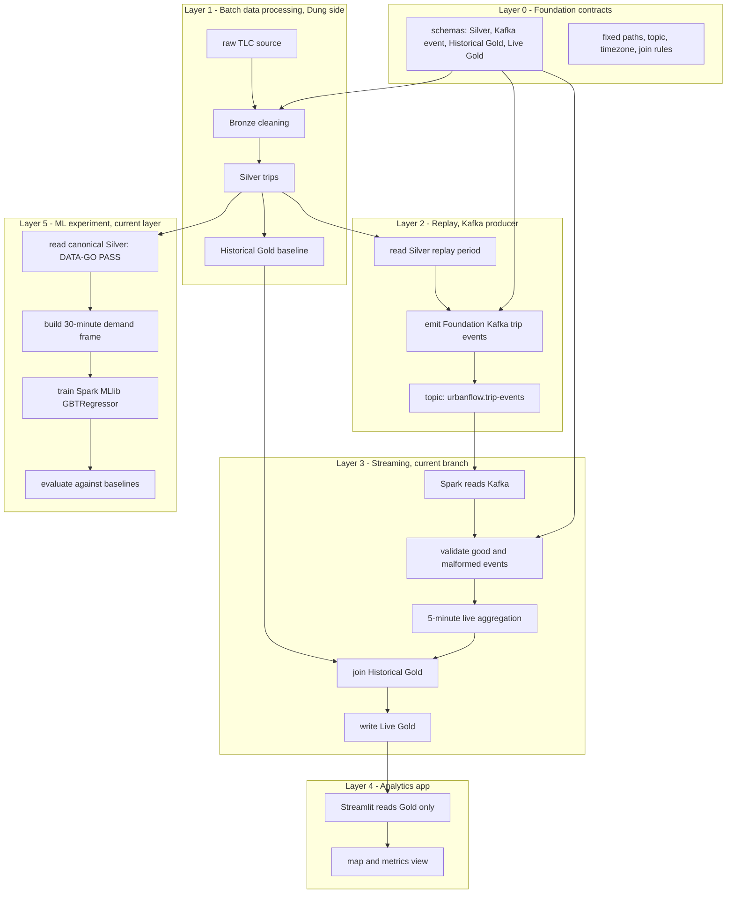

# UrbanFlow Streaming and Distributed Demand Forecasting Implementation Plan

> **For agentic workers:** REQUIRED SUB-SKILL: Use `superpowers:subagent-driven-development` (recommended) or `superpowers:executing-plans` to implement this plan task-by-task. Steps use checkbox (`- [ ]`) syntax for tracking.

**Goal:** Finish the UrbanFlow streaming path without waiting for upstream integration, then build and evaluate one useful distributed ML model that forecasts taxi pickup demand per zone for the next 30-minute window.

**Architecture:** Workstream A keeps the frozen Foundation 1.0.0 contracts and completes fixture-first Streaming, Kafka-to-Spark, Batch-Gold-to-Streaming, and final end-to-end proof. Workstream B starts as an isolated `urbanflow-ml` experiment that reads canonical Silver Parquet but imports no Batch code; it builds a zero-inclusive time series, trains one Spark MLlib `GBTRegressor` on two Spark workers, compares it with non-ML baselines, and produces versioned model and forecast artifacts. Only a successful model may enter the official pipeline through the Foundation change-control process.

**Tech Stack:** Python 3.13, Apache Spark/PySpark 4.2.0, Spark Structured Streaming, Spark MLlib DataFrame API, Kafka 3.9.1, SeaweedFS S3A, Parquet, PyYAML, pytest, Streamlit for the current demo UI.

**Spec:** This plan is self-contained. It is based on `STATUS.md`, `AGENTS.md`, `urbanflow-foundation/contracts/`, `urbanflow-foundation/docs/`, and the current branch source inspected on 2026-09-13.

## Global Constraints

- Foundation 1.0.0 is frozen during the experiment.
- Do not change Silver, Kafka event, Historical Gold, or Live Gold schemas inside an application subproject.
- Analytics and Spark session timezone is exactly `America/New_York`.
- Kafka topic is exactly `urbanflow.trip-events`, with 4 partitions and replication factor 1.
- Canonical Silver input is `s3a://urbanflow/silver/trips/`.
- Historical Gold input is `s3a://urbanflow/gold/historical_zone_baseline/`.
- Live Gold output is `s3a://urbanflow/gold/live_zone_metrics/`.
- Streaming checkpoint is `s3a://urbanflow/checkpoints/live_trip_metrics/`.
- Application subprojects share contracts and physical data, never Python source imports.
- Streaming development does not wait for Batch or Replay. It uses Foundation fixtures first.
- ML development may scaffold and test with small data, but a credible result must use canonical Silver over the frozen chronological periods in this plan.
- Do not train on the February 2023 test/replay label data.
- Do not use random train/test splits for this forecast.
- Do not silently drop invalid data, missing time buckets, failed predictions, or unsupported zones.
- Generated Parquet, models, checkpoints, event logs, reports with large row data, and local secrets stay out of Git.
- Keep the current Streamlit app for the first integrated demo. The existing FastAPI replacement plan is deferred unless Streamlit blocks an acceptance test.
- Use test-driven development for every code change and make a focused commit after every task.

---

## 0. Current Execution Map

This section is the fast map for the project owner. It answers:

```text
What are the layers?
What is done now?
What proves it is done?
Where is the current blocker?
```

### Plain-text workflow

Use this diagram when your editor does not render Mermaid.

```text
Layer 0 - Foundation contracts
  schemas + paths + topic + timezone
        |
        | contract rules
        v
Layer 1 - Batch / Dung data processing
  raw TLC data -> Bronze -> Silver -> Historical Gold
        |                         |
        | Silver                  | Historical Gold
        v                         v
Layer 2 - Replay Kafka producer   |
  Silver replay period -> urbanflow.trip-events
        |                         |
        | Kafka trip events       |
        v                         |
Layer 3 - Streaming / current branch
  read Kafka -> validate -> 5-minute aggregation
  -> join Historical Gold -> write Live Gold
        |
        | Live Gold
        v
Layer 4 - Analytics app
  Streamlit reads Gold only -> map + metrics view

Layer 5 - ML experiment, current layer
  Silver DATA-GO PASS -> 30-minute demand frame
  -> leakage-safe features -> baselines
  -> Spark MLlib model -> distributed proof
  -> evaluate against baselines
```

### Progress tracker

Read this table first to know where the project is now.

| Stage | Owner | Input | Output | Evidence | Status | Next action |
|---|---|---|---|---|---|---|
| Foundation contracts | Foundation | Contract files | Frozen schemas and paths | `FOUNDATION FIXTURES = PASS` in `STATUS.md` | DONE | Change only through Foundation change-control |
| Batch data processing | Dung / Batch branch | TLC raw files on `D:\UrbanFlow\local-data\nyc-tlc` | Silver + Historical Gold on S3A | `batch-gold-boundary.md`; 534240 Historical Gold rows; 0 duplicate keys | DONE for current integration | Confirm if Dung has a newer branch than `origin/urbanflow-batch` |
| Replay Kafka producer | Replay branch | Silver replay period | 10000 Kafka events for run `task6-20260914-003` | Replay output: 10000 sent, 0 rejected, 0 send errors | DONE for bounded run | Use larger/repeated run only if performance demo is needed |
| Streaming data pipeline | Current branch | Kafka events + Historical Gold | Live Gold at `s3a://urbanflow/gold/live_zone_metrics/task6/task6_20260914_003/` | `end-to-end-streaming.md`; 4394 reference rows = 4394 live rows; 0 mismatches | DONE for bounded data pipeline | App visual smoke if UI demo is required |
| Analytics app | Current branch | Live Gold / Historical Gold | Streamlit map and metrics | `analytics-smoke.md`; 4394 view rows; Streamlit HTTP 200 on `127.0.0.1:8501` | DONE for smoke | Keep running app for demo or stop PID `14016` when finished |
| ML experiment | New/experimental work | Canonical Silver | Demand forecast model + report | `silver-audit.md`; `demand-frame-smoke.md`; feature tests cover leakage and DST behavior; Spark evaluation tests cover metrics and baseline leakage | DATA-GO PASS, demand-frame smoke PASS, feature unit gate PASS, baseline/metrics gate PASS | Train distributed GBT and compare with baselines |

### How to track progress

There are three tracking levels:

```text
1. plan.md
   The owner view: stages, gates, risks, and next actions.

2. STATUS.md
   The measured state: commands run, row counts, output paths, PASS/FAIL.

3. docs/results/*.md
   The proof files: detailed result per gate.
```

Every completed stage must have all three:

```text
Status = DONE/PASS
Evidence file = exists
Verification command = recorded
Measured output = row counts, path, or exact PASS text
```

### Layered workflow



### Current output and position

Current branch position:

```text
branch: urbanflow-streaming
latest completed commit: 446579e test(ml): audit silver data-go gate
local branch state: ahead of origin/urbanflow-streaming by 10 commits before the latest documentation refresh
```

Current runtime output:

```text
Kafka topic exists:
  urbanflow.trip-events, 4 partitions, replication factor 1

Kafka -> Spark smoke output:
  PASS
  run_id: smoke-task4-final-001
  valid_count: 7
  invalid_count on canonical topic: 0
  malformed invalid_count: 1

Batch Historical Gold boundary:
  PASS
  path: s3a://urbanflow/gold/historical_zone_baseline/
  row_count: 534240
  duplicate_key_count: 0

Integrated Streaming bounded run:
  PASS
  run_id: task6-20260914-003
  replay_events: 10000
  invalid_rows: 0
  reference_rows: 4394
  live_rows: 4394
  mismatched_rows: 0
  output_path: s3a://urbanflow/gold/live_zone_metrics/task6/task6_20260914_003/
  checkpoint_path: s3a://urbanflow/checkpoints/live_trip_metrics/task6/task6_20260914_003/
  evidence: urbanflow-streaming/docs/results/end-to-end-streaming.md

Analytics app smoke:
  PASS
  live_rows: 4394
  prepared analytics view rows: 4394
  latest-window rows: 1
  Streamlit HTTP: 200
  Streamlit URL: http://127.0.0.1:8501
  Streamlit PID: 14016
  evidence: urbanflow-streaming/docs/results/analytics-smoke.md

ML Silver DATA-GO:
  PASS
  silver_rows: 15448035
  required months present:
    2022-08, 2022-09, 2022-10, 2022-11, 2022-12, 2023-01, 2023-02
  missing required months: none
  invalid range counts: all 0
  evidence: urbanflow-ml/docs/results/silver-audit.md

ML Demand Frame smoke:
  PASS
  run_id: task9-smoke-20260915-001
  date range: 2023-01-02 to 2023-01-02
  zones: 265
  rows: 12720
  output_path: s3a://urbanflow/dev/ml/demand_frame/task9-smoke-20260915-001/
  evidence: urbanflow-ml/docs/results/demand-frame-smoke.md

ML Feature unit gate:
  PASS
  tests: 5 Spark unittest cases
  covers: target leakage, trailing window exclusion, previous-day lag,
          missing lag flags, zone isolation, spring-forward gap behavior,
          deterministic cyclical features
```

So the project is here:

```text
Foundation contracts         DONE
Streaming fixture mode       DONE
Spark/Kafka/S3A runtime      DONE
Kafka -> Spark boundary      DONE
Batch Gold -> Streaming      DONE
Integrated Streaming demo    DONE for bounded data pipeline
Analytics app smoke          DONE
ML experiment                CURRENT LAYER: baseline/metrics gate PASS, distributed GBT training next
```

### Storage map

Logical distributed storage:

```text
S3A bucket: urbanflow
Historical Gold contract path:
  s3a://urbanflow/gold/historical_zone_baseline/
Live Gold contract path:
  s3a://urbanflow/gold/live_zone_metrics/
Streaming checkpoint path:
  s3a://urbanflow/checkpoints/live_trip_metrics/
```

Runtime storage service:

```text
service: SeaweedFS S3
container address: http://seaweedfs:8333
host address: http://localhost:8333
```

Physical Docker storage on this machine:

```text
D:\Docker\DockerDesktopWSL\disk\docker_data.vhdx
```

Kafka event data is in Docker volume `kafka-data`.
SeaweedFS object data is in Docker volume `seaweed-data`.
Both are physically inside the Docker Desktop storage file above.

### Evidence gates

A task is not done because an agent says it is done. It is done only when
the matching gate below has fresh evidence.

| Area | Done gate | Current evidence | Status |
|---|---|---|---|
| Foundation fixtures | `docker compose run --rm foundation-check` prints `FOUNDATION FIXTURES = PASS` | recorded in `STATUS.md` | DONE |
| Fixture Streaming logic | focused pytest passes and fixture output matches Foundation expected output | `8 passed, 5 skipped` earlier; later focused runs include these tests | DONE |
| Safe finite fixture execution | test proves output path cannot overwrite Foundation fixture paths | commit `5974c97` | DONE |
| Runtime lock | Spark, S3A, Kafka connector smoke tests pass in Docker | commit `32a30f5` and `environment-lock.md` | DONE |
| Kafka -> Spark boundary | real Kafka topic, Spark reads events, malformed row remains visible | commit `556ecbb`; `kafka-spark-smoke.md` | DONE |
| Batch Gold -> Streaming boundary | real Parquet at `s3a://urbanflow/gold/historical_zone_baseline/` loads and validates | `batch-gold-boundary.md`; row count 534240; duplicate keys 0 | DONE |
| Integrated demo | Kafka + Historical Gold -> Live Gold exact reference comparison | `end-to-end-streaming.md`; run `task6-20260914-003`; 10000 events; 4394 Live rows; 0 mismatches | DONE |
| Analytics app smoke | app reads Gold only and prepares map/table/chart-ready rows | `analytics-smoke.md`; 4394 view rows; HTTP 200 from Streamlit | DONE |
| ML DATA-GO | canonical Silver covers required time periods | `silver-audit.md`; 15448035 rows; missing months none; invalid range counts 0 | PASS |
| ML demand frame smoke | zero-inclusive zone x 30-minute frame writes to dev S3A path | `demand-frame-smoke.md`; 265 zones x 48 slots = 12720 rows | PASS |
| ML leakage-safe features | features use only prior windows or earlier service dates | Spark feature tests; 5 cases; target label changes do not alter features | PASS |
| ML baseline/metrics gate | honest train-only baselines and deterministic evaluation metrics | Spark evaluation tests; 6 cases; MAE/RMSE/WAPE/bias/clamp/top-k recall, summary slices, and leakage checks | PASS |
| ML DISTRIBUTION-GO | Spark master has two workers and event logs show two executors doing work | not checked yet | NOT STARTED |
| ML QUALITY-GO | GBT beats baselines on untouched test period | not checked yet | NOT STARTED |

### What must happen next

The project is now at Layer 5. The integrated Streaming data-pipeline demo,
Analytics smoke, ML Silver DATA-GO, one-day demand-frame writer smoke,
leakage-safe feature unit gate, and baseline/metrics gate have passed. The
next implementation block is distributed model training.

Streaming evidence:

```text
Kafka trip events + Batch Historical Gold
-> Streaming Live Gold
-> exact static reference comparison
```

Fresh evidence command:

```powershell
docker-compose --profile integration run --rm spark-submit `
  --master local[2] `
  /workspace/urbanflow-streaming/tests/verify_integrated_run.py `
  --run-id task6-20260914-003 `
  --expected-events 10000
```

This returned `END TO END STREAMING = PASS` on 2026-09-14. The Streaming UI
smoke also passed with Streamlit HTTP 200 on `http://127.0.0.1:8501`.

ML evidence command:

```powershell
docker-compose --profile integration run --rm spark-submit `
  --conf spark.ui.showConsoleProgress=false `
  --master local[2] `
  /workspace/urbanflow-ml/spark/audit_silver.py
```

This returned `ML DATA-GO = PASS` on 2026-09-14 after missing raw TLC months
were downloaded to `D:\UrbanFlow\local-data\nyc-tlc` and Batch rebuilt Silver.
The Bronze landing command wrote the new months but exited 1 because its row
count assertion compares selected-period input rows with the already-appended
Bronze total. The follow-up Bronze-to-Silver job exited 0 with
`BRONZE TO SILVER = PASS`, and the independent ML audit is the current gate for
whether training can proceed.

Demand-frame evidence command:

```powershell
docker-compose --profile integration run --rm spark-submit `
  --conf spark.ui.showConsoleProgress=false `
  --master local[2] `
  /workspace/urbanflow-ml/spark/build_demand_frame.py `
  --run-id task9-smoke-20260915-001 `
  --start-date 2023-01-02 `
  --end-date 2023-01-02 `
  --zone-lookup s3a://urbanflow/bronze/zone_lookup/
```

This returned `ML DEMAND-FRAME = PASS` on 2026-09-15 with 265 zones and 12720
rows for one local day. This is a writer smoke, not the full training frame.

---

## 1. Executive Decision

### Selected useful AI task

Predict the number of taxi pickups for each pickup zone in the next 30-minute window.

The model answers one operational question:

```text
At forecast time t, how many pickups should we expect in each zone during [t, t + 30 minutes)?
```

The optional anomaly signal is not a second model. It is derived from the forecast residual:

```text
residual = actual_trip_count - predicted_trip_count
```

This keeps the project focused on one learned task. The same output can support:

- vehicle positioning before demand arrives;
- passenger waiting-time reduction as a possible downstream benefit;
- lower empty cruising as a possible downstream benefit;
- city monitoring of zones where real demand differs strongly from expected demand.

These social benefits are hypotheses, not facts proven by this dataset. UrbanFlow can prove forecast quality and ranking quality. It cannot claim measured waiting-time or emission reduction without vehicle movement and service outcome data.

### Selected model

Use one global Spark MLlib `GBTRegressor` model for all zones.

Why it fits this project:

- It learns non-linear links between zone, time, recent demand, daily patterns, and weekly patterns.
- It is available in the current Spark stack and uses the primary DataFrame-based ML API.
- Spark distributes the rows and tree split statistics across workers.
- It avoids adding a GPU platform, deep-learning framework, model server, or orchestration service.
- One global model is easier to operate than one model per zone.

Important technical correction:

```text
Spark GBT is distributed ML, but it is not neural-network all-reduce training.
Workers process row partitions and compute split/loss statistics.
Spark combines these statistics to build each tree.
Boosting builds trees in sequence, because each new tree corrects earlier errors.
```

If the course requirement later says "each node must train gradients and all-reduce them," this selected algorithm no longer meets the literal requirement. That would require a new design using a system such as PyTorch distributed training, Horovod, or distributed XGBoost. Do not add one of those systems without a separate approved plan.

### Selected forecast grain

- Spatial grain: one TLC pickup zone.
- Time grain: one 30-minute local wall-clock bucket.
- Forecast horizon: one bucket, 30 minutes ahead.
- Training style: rolling one-step-ahead forecast using only information available before the target bucket starts.

Thirty minutes is selected instead of five minutes because it is less sparse, more useful for positioning, and more realistic for the current two-worker teaching cluster. Streaming remains at its frozen five-minute grain; forecast data stays separate until a versioned integration contract is approved.

---

## 2. Technology Note in English B1-B2

### Apache Spark

Apache Spark is a distributed data processing engine from the Apache Software Foundation. It splits a large dataset into partitions. Worker processes handle partitions in parallel, and the driver coordinates the job. It was created to make repeated large-data operations faster and easier, including iterative machine learning.

Example: Worker 1 handles trips from some partitions while Worker 2 handles other partitions. Both return partial statistics to the Spark driver.

Similar systems include Apache Flink, Dask, and Ray. A simple opposite is a single-machine Pandas program, where one process handles all rows in one machine's memory.

### Spark MLlib

MLlib is Spark's machine learning library. Apache Spark provides it. It offers algorithms, feature transformers, pipelines, evaluation tools, and model persistence. The DataFrame API in `pyspark.ml` is the main API; the older RDD API is in maintenance mode.

Similar tools include scikit-learn, XGBoost, TensorFlow, and PyTorch. MLlib is strongest when data is already in Spark and classic ML is enough. It is not a full deep-learning GPU framework.

### Gradient-Boosted Trees

A Gradient-Boosted Tree regressor is an ensemble model. It builds small decision trees one after another. Each new tree tries to reduce the errors left by the previous trees. It is useful for structured table data with non-linear patterns.

Similar models include Random Forest and XGBoost. A simple opposite is a fixed historical-average rule. A linear model is also simpler and easier to explain, but it may miss important interactions between location, time, and recent demand.

---

## 3. Evidence From the Current Repository

The plan assumes the following inspected state:

- Current branch: `urbanflow-streaming` at `68ed3bd`.
- `origin/urbanflow-batch` at `749ea2e` is independently complete.
- `origin/urbanflow-replay` at `a7f2cfb` is independently complete.
- Batch owns January 2023 historical processing and February 2023 replay Silver.
- Replay can publish canonical February Silver to Kafka at measured rates from 100 to 5,000 events/second.
- Streaming already has event parsing, malformed-row visibility, five-minute event-time aggregation, a historical left join, demand ratio, z-score, restart-safe Parquet writing, metrics, and a Streamlit Gold reader.
- Streaming unit tests already cover the Foundation fixture, malformed events, boundary/null rules, watermark attachment, and checkpoint restart.
- Cross-project tests still missing are Replay to Streaming, Spark to Kafka, Batch Historical Gold to Streaming, and final end-to-end acceptance.
- Root `compose.yaml` has Spark 4.2.0 and two workers, but the current Streaming `spark-packages.conf` still names a Spark Kafka connector at 4.0.1. This version mismatch must be resolved by a real smoke test before integration is called stable.
- `urbanflow-streaming/config/settings.example.yaml` points its offline Live Gold setting at a Foundation expected fixture file. A runner must never write generated Parquet into a read-only expected-fixture path.

Unknowns that must be measured, not guessed:

- Exact canonical Historical Gold row count on the integration environment.
- Exact S3A dependency set that passes both Parquet and Kafka integration with Spark 4.2.0.
- Available Silver months before January 2023.
- Whether the current 768 MB per worker is enough for the full GBT training frame.
- Whether distributed execution is faster than local execution at this data size.

---

## 4. Options and Trade-offs

### Model option A: Spark MLlib GBTRegressor - recommended

Benefits:

- Good fit for non-linear tabular data.
- Native Spark pipeline and model persistence.
- Distributed row processing and split-statistic aggregation.
- No new platform beyond the project's Spark cluster.
- Feature importance supports teaching and basic explanation.

Costs and risks:

- Trees are built sequentially during boosting, so scaling is not unlimited.
- Memory can be tight on two 768 MB workers.
- Prediction intervals are not built in.
- Raw predictions can be negative and need a documented clamp to zero.
- Feature importance does not prove causation.

### Model option B: Spark GeneralizedLinearRegression with Poisson family

Benefits:

- A count model matches non-negative trip counts.
- Easier to explain and audit.
- Smaller model and lower resource cost.

Costs and risks:

- Linear structure may underfit zone-time interactions.
- Feature engineering becomes more important.
- It may produce a weaker demo if the historical patterns are strongly non-linear.

Use this only as a fallback if GBT cannot fit within the approved cluster after the memory recovery steps in this plan. Replacing the selected model requires a short decision record and the same untouched test set.

### Model option C: LSTM, graph neural network, or transformer

Benefits:

- Can represent complex spatial and temporal dependence.
- Strong research value on large, rich datasets.

Costs and risks:

- Requires a new deep-learning and distributed-training stack.
- Harder to test, explain, reproduce, and serve.
- Needs more data, tuning, compute, and engineering than this project needs.
- Creates a weak teaching outcome if the system complexity hides data quality and evaluation mistakes.

Decision: reject for this project version.

### Integration option A: Batch precomputed forecast table - recommended after model GO

The ML job scores known future windows for the replay period and writes a separate forecast dataset. The analytics layer can read it after a Foundation contract is added.

Benefits: deterministic demo, no model inside the stream, easy replay and comparison.

Cost: it is not a true always-on online forecast service.

### Integration option B: Load the model inside Structured Streaming

Benefits: closer to real-time inference.

Costs: recent lag features require new state, model refresh is harder, failures affect the live pipeline, and it changes Streaming responsibilities.

Decision: reject for the first version.

### UI option

Keep Streamlit for the first final demo. It already satisfies the required thin Gold-reader architecture. Do not execute `urbanflow-streaming/docs/plans/2026-09-12-replace-streamlit-fastapi-frontend.md` during this plan unless a recorded acceptance failure proves Streamlit is a blocker.

---

## 5. Target Architecture and Ownership

```text
Independent development now

Foundation Kafka fixture + Historical Gold fixture
                    |
                    v
          urbanflow-streaming
                    |
                    v
       local generated Live Gold -> Streamlit


Integrated streaming

urbanflow-batch Silver -> urbanflow-replay -> Kafka ----+
urbanflow-batch Historical Gold ------------------------+--> urbanflow-streaming
                                                               |
                                                               v
                                                   canonical Live Gold -> Streamlit


ML experiment

urbanflow-batch canonical Silver
                    |
                    v
             urbanflow-ml
       dense 30-minute count frame
       -> temporal features
       -> GBT training on 2 workers
       -> model + test forecasts + report


Only after ML acceptance and Foundation versioning

versioned Forecast Gold -> analytics actual-versus-forecast view
```

Ownership rules:

| Artifact | Writer | Readers | Rule |
|---|---|---|---|
| Canonical Silver | `urbanflow-batch` | Replay; ML experiment | ML never rewrites it |
| Kafka events | `urbanflow-replay` | Streaming | Streaming does not repair events silently |
| Historical Gold | `urbanflow-batch` | Streaming | Streaming uses exact contract keys |
| Live Gold | `urbanflow-streaming` | Analytics | Analytics does not reproduce ETL |
| Experimental training frame | `urbanflow-ml` | ML only | Use a development path |
| Experimental model | `urbanflow-ml` | ML scorer | Immutable per run ID |
| Experimental forecasts | `urbanflow-ml` | Evaluation only | Not official Gold before promotion |

No code in `urbanflow-ml` may import `urbanflow-batch`, `urbanflow-replay`, or `urbanflow-streaming` modules. It may read Foundation contract files as documentation and validate data against its own matching schema declarations.

---

## 6. Data and Forecast Specification

### Required credible data period

Use these fixed periods for the first credible result:

```yaml
source_warmup_start: 2022-08-01
train_start: 2022-08-08
train_end: 2022-12-31
validation_start: 2023-01-01
validation_end: 2023-01-31
test_start: 2023-02-01
test_end: 2023-02-28
```

Reasoning:

- The seven-day warm-up creates the first weekly lag.
- Validation is after training.
- The untouched test period matches the existing February replay period.
- January validation can be used for model choice, while February remains unseen until the final evaluation.

If only January and February 2023 Silver exist, use `profile: smoke` to prove code execution. Label every result `NOT FOR MODEL QUALITY CLAIMS`. Do not lower the credible-data gate to make the model pass.

### Training row grain

One row per:

```text
pickup_zone_id + service_date + half_hour_slot
```

Where `half_hour_slot` is 0 through 47 and the label is the pickup count during that local 30-minute target window.

Build a complete zero-inclusive grid from eligible taxi zones, local service dates, and valid local slots. Do not omit zero-demand rows. Follow Foundation DST rules:

- spring-forward invalid local slots are not eligible;
- fall-back repeated clock time contributes to the same wall-clock slot;
- derive calendar fields in `America/New_York`;
- never infer timezone from the host.

### Features allowed at forecast time

```text
pickup_zone_id category
target day_of_week
target half_hour_slot
target month
target is_weekend
target time_of_day_sin
target time_of_day_cos
lag_1_count             previous valid 30-minute window
lag_2_count             two valid windows before target
trailing_2h_mean        prior four valid windows, target excluded
same_slot_prev_day      same local slot on previous service date
same_slot_prev_week     same local slot seven service dates earlier
prev_day_missing        1 when the daily lag is unavailable
prev_week_missing       1 when the weekly lag is unavailable
```

Features forbidden because of leakage or scope:

- target-window trip count or any value computed from it;
- future trips, future Live Gold, or test-period aggregate statistics;
- dropoff time for a trip that has not completed at forecast time;
- full-dataset normalization fitted before the temporal split;
- weather, events, traffic, or transit status in version one;
- passenger/fare outcomes that become known after pickup and do not answer demand.

### Internal experimental prediction schema

This is not a Foundation contract:

```text
forecast_window_start   timestamp, not null
forecast_window_end     timestamp, not null
pickup_zone_id          integer, not null
predicted_trip_count    double, not null, >= 0 after clamp
raw_prediction          double, not null
model_run_id            string, not null
generated_at            timestamp, not null, UTC
```

Evaluation data may add `actual_trip_count`, `absolute_error`, and `residual`. Production-style forecast data must not include future actual values.

---

## 7. Success Criteria and Stop/Go Gates

### Streaming GO

All conditions are required:

- Foundation validator prints `FOUNDATION FIXTURES = PASS`.
- Existing Streaming unit tests pass unchanged.
- Fixture mode writes generated Parquet to a generated-output directory, never into Foundation fixtures.
- Kafka to Spark Test G passes without an integration-only adapter.
- Batch Historical Gold loads with the exact Foundation schema.
- Replay events parse with zero invalid rows for a known-valid run.
- A controlled end-to-end run produces Live Gold and the app shows current count, historical mean, demand ratio, map, and unusual zones.
- Restart with the same checkpoint does not duplicate committed source data.
- Runtime evidence records input rows, processed rows per second, batch duration, watermark, invalid rows, and output rows.

### ML DATA-GO

- Canonical Silver contains the full warm-up, train, validation, and test periods.
- Schema and nullability match Foundation Silver 1.0.0.
- Every pickup zone exists in the supplied zone lookup.
- No test labels enter training, feature fitting, baseline fitting, or hyperparameter choice.
- The zero-inclusive grid has unique zone/date/slot keys.
- Missing lags are represented by explicit flags and documented fills.

### ML DISTRIBUTION-GO

- Spark master reports two registered workers.
- Training runs with `--master spark://spark-master:7077`.
- Spark event logs show successful tasks on at least two non-driver executor IDs.
- The model output is readable after the Spark application exits.
- A repeated run with the same input/config/seed gives metrics within a documented tolerance.

### ML QUALITY-GO

Use the untouched February 2023 test period exactly once for the final decision. All conditions are required:

- Primary metric: model MAE is at least 5% lower than the better of the two baselines.
- Secondary metric: model WAPE is lower than the better baseline.
- Operational metric: mean top-10 zone recall per window is not lower than the better baseline.
- Bias is reported with sign; systematic underprediction at peaks is discussed.
- No borough with enough test activity has MAE more than 10% worse than its stronger baseline without a written reason and mitigation.
- Prediction clamp rate is below 1% of test rows. A higher rate triggers model review.
- Results include all valid zones, zero-demand windows, peak windows, and low-volume zones.

If the model fails QUALITY-GO, keep the historical baseline as the official UrbanFlow behavior. A failed honest experiment is an acceptable scientific result. Do not tune on the test set.

### PROMOTION-GO

Only after DATA-GO, DISTRIBUTION-GO, and QUALITY-GO:

- Write a Foundation change proposal.
- Treat the new forecast dataset and new producer/consumer ownership as a backward-compatible Foundation minor release candidate.
- Add contract, fixture, validator, storage path, ownership, changelog, producer test, consumer test, and integration test before showing forecast as official Gold.

---

## 8. Standard Question Framework for Issues

For every issue, write a short record using these questions before changing design:

1. **Purpose:** Which user or system outcome is blocked?
2. **Evidence:** What command, row sample, metric, log, or contract proves the issue?
3. **Ownership:** Which subproject owns the bad output or behavior?
4. **Contract:** Is this an internal bug, configuration issue, or cross-project contract change?
5. **Time:** Was every feature/value available at the real forecast time?
6. **Data:** Does the issue affect zeros, nulls, DST, low-volume zones, or rejected rows?
7. **Distributed system:** Is the failure in driver memory, executor memory, shuffle, skew, storage, network, or serialization?
8. **Model:** Is the failure underfitting, overfitting, leakage, drift, weak features, or a poor metric?
9. **Human impact:** Who benefits, who may be harmed, and which zones are hidden by an average metric?
10. **Teaching value:** Can a student explain the decision and reproduce the evidence?
11. **Options:** What are the smallest two or three fixes, and what does each cost?
12. **Decision:** Which option is selected, why, and what evidence would reverse it?
13. **Verification:** Which exact test proves the issue is fixed?
14. **Rollback:** Which commit or immutable artifact remains the last known good state?

Viewpoints required in reviews:

| Viewpoint | Main question |
|---|---|
| Product | Does the output answer a useful mobility question? |
| Data engineering | Is the data complete, typed, partitioned, and reproducible? |
| Data science | Is evaluation chronological, baseline-based, and leakage-free? |
| Distributed systems | Did work really use multiple executors, and can it recover? |
| MLOps | Can we trace model, code, data, config, and metrics? |
| Social value | Are benefits stated carefully and results checked across boroughs? |
| Security/privacy | Are there secrets or person-level identifiers? |
| Teaching | Can the architecture and trade-offs be explained in plain English? |

---

## 9. Implementation Tasks

### Task 0: Create an isolated execution branch and record the baseline

**Files:**

- Read: `STATUS.md`
- Read: `AGENTS.md`
- Read: `urbanflow-foundation/contracts/*`
- Read: `urbanflow-foundation/docs/*`
- Modify after checks: `STATUS.md`

**Interfaces:**

- Consumes: current `urbanflow-streaming` branch and fetched remote refs.
- Produces: an isolated implementation worktree/branch and an evidence-backed starting record.

- [ ] **Step 1: Use the worktree skill at execution time**

Invoke `superpowers:using-git-worktrees`. Do not implement directly on `main`, `origin/urbanflow-batch`, or `origin/urbanflow-replay`.

- [ ] **Step 2: Record exact Git state**

Run:

```powershell
git status --short --branch
git branch -a -vv
git log -1 --format='%H %cI %s' origin/urbanflow-batch
git log -1 --format='%H %cI %s' origin/urbanflow-replay
git log -1 --format='%H %cI %s' origin/urbanflow-streaming
```

Expected: no remote branch is checked out or modified; untracked user files are preserved.

- [ ] **Step 3: Confirm plan scope**

Run:

```powershell
rg -n "Foundation version|integrated_path|topic|timezone|producer|consumer" urbanflow-foundation
```

Expected: values match Global Constraints.

- [ ] **Step 4: Update only factual status lines**

Add the execution branch name, commit SHA, date, and selected phase to `STATUS.md`. Do not mark any test as passed before running it.

- [ ] **Step 5: Commit**

```powershell
git add STATUS.md
git commit -m "docs: record UrbanFlow execution baseline"
```

### Task 1: Prove the current Streaming implementation against fixtures

**Files:**

- Test: `urbanflow-streaming/tests/test_pipeline.py`
- Test: `urbanflow-streaming/tests/test_data_access.py`
- Read: `urbanflow-foundation/fixtures/`

**Interfaces:**

- Consumes: Foundation 1.0.0 Kafka and Gold fixtures.
- Produces: a clean independent Streaming baseline before integration work.

- [ ] **Step 1: Run Foundation validation**

```powershell
python urbanflow-foundation/checks/validate_contract_fixtures.py
```

Expected: `FOUNDATION FIXTURES = PASS`.

- [ ] **Step 2: Run the smallest Streaming test suite**

```powershell
Set-Location urbanflow-streaming
pytest -q tests/test_pipeline.py tests/test_data_access.py
```

Expected: all tests pass. If a test fails, invoke `superpowers:systematic-debugging` before editing.

- [ ] **Step 3: Record versions used by the passing run**

```powershell
python --version
java -version
python -c "import pyspark; print(pyspark.__version__)"
```

Expected: actual values are written to the result record; intended versions are not reported as validated versions.

- [ ] **Step 4: Commit only if evidence docs changed**

```powershell
git add STATUS.md urbanflow-streaming/docs
git commit -m "test(streaming): record fixture baseline evidence"
```

### Task 2: Make offline fixture execution safe and finite

**Files:**

- Create: `urbanflow-streaming/config/settings.fixture.example.yaml`
- Create: `urbanflow-streaming/tests/test_fixture_runner.py`
- Modify: `urbanflow-streaming/spark/live_trip_metrics.py`
- Modify: `.gitignore`
- Modify: `urbanflow-streaming/README.md`

**Interfaces:**

- Consumes: `main()`, `_settings(path)`, and Foundation fixture directory.
- Produces: `build_queries(...)`, an `--available-now` fixture mode, and generated Parquet under `urbanflow-streaming/output/fixture-live-gold/`.

- [ ] **Step 1: Write failing tests for output protection and finite trigger**

Tests must assert:

```python
def test_fixture_output_cannot_equal_foundation_fixture_path(): ...
def test_output_and_checkpoint_must_differ(): ...
def test_fixture_mode_selects_available_now_trigger(): ...
```

The protection function interface is:

```python
def validate_runtime_paths(output_path: str, checkpoint_path: str) -> None:
    """Reject equal paths and any generated output below urbanflow-foundation/fixtures."""
```

- [ ] **Step 2: Run tests and confirm failure**

```powershell
pytest -q tests/test_fixture_runner.py
```

Expected: fail because `validate_runtime_paths` and finite fixture behavior do not exist.

- [ ] **Step 3: Implement the minimum safe runner change**

Add `--available-now` to `main()`. For file fixture mode, use `.trigger(availableNow=True)` and wait for completion. Keep Kafka mode on the configured processing-time trigger. Call `validate_runtime_paths` before either query starts.

- [ ] **Step 4: Add safe fixture configuration**

Use these paths:

```yaml
profile: fixture
storage:
  historical_baseline: ../urbanflow-foundation/fixtures/gold/historical_zone_baseline.jsonl
  live_metrics: output/fixture-live-gold
  streaming_checkpoint: .checkpoints/fixture-live-trip-metrics
```

Input fixture data must be copied into a temporary input directory because Spark file streams consume directories. The copy is generated and ignored by Git.

- [ ] **Step 5: Run focused and existing tests**

```powershell
pytest -q tests/test_fixture_runner.py tests/test_pipeline.py tests/test_data_access.py
```

Expected: all pass.

- [ ] **Step 6: Run fixture mode twice**

First run creates Live Gold. Second run with the same checkpoint does not duplicate output. Compare key values with `expected_live_zone_metrics.jsonl`.

- [ ] **Step 7: Commit**

```powershell
git add .gitignore urbanflow-streaming/config/settings.fixture.example.yaml urbanflow-streaming/spark/live_trip_metrics.py urbanflow-streaming/tests/test_fixture_runner.py urbanflow-streaming/README.md
git commit -m "feat(streaming): add safe finite fixture execution"
```

### Task 3: Lock the Spark, Kafka, and S3A runtime combination

**Files:**

- Modify: `urbanflow-streaming/spark-packages.conf`
- Create: `urbanflow-streaming/docs/environment-lock.md`
- Modify if integration requires it: `compose.yaml`

**Interfaces:**

- Consumes: Spark 4.2.0 image, Kafka 3.9.1, SeaweedFS 4.45.
- Produces: one validated dependency set for both Kafka source and S3A Parquet.

- [ ] **Step 1: Write down the candidate lock**

The first candidate is:

```text
Spark image: apache/spark:4.2.0-python3
Spark Kafka connector: org.apache.spark:spark-sql-kafka-0-10_2.13:4.2.0
Hadoop AWS: org.apache.hadoop:hadoop-aws:3.5.0
SeaweedFS: urbanflow/seaweedfs:4.45
Kafka broker: 3.9.1
Java: 21.x
```

Do not keep the current 4.0.1 Kafka connector with Spark 4.2.0.

- [ ] **Step 2: Validate Compose before starting services**

```powershell
docker compose config --quiet
```

Expected: exit code 0.

- [ ] **Step 3: Run Spark local and S3A smoke tests**

```powershell
docker compose run --rm foundation-check
docker compose run --rm spark-submit --master local[2] /workspace/docker/spark/local_smoke_test.py
docker compose run --rm spark-submit --master local[2] /workspace/docker/spark/s3a_smoke_test.py
```

Expected: Foundation pass and S3A `WRITE`, `READ`, and `DATA` pass.

- [ ] **Step 4: Verify connector class loading**

Run a minimal Spark job that calls:

```python
spark.readStream.format("kafka").option("kafka.bootstrap.servers", address).option("subscribe", topic).load()
```

Expected: no `ClassNotFoundException`, `NoSuchMethodError`, Scala binary mismatch, or AWS SDK conflict.

- [ ] **Step 5: Record only the combination that passed**

Include image digests, package coordinates, Java version, Python version, Spark version, and command output summary in `environment-lock.md`.

- [ ] **Step 6: Commit**

```powershell
git add compose.yaml urbanflow-streaming/spark-packages.conf urbanflow-streaming/docs/environment-lock.md
git commit -m "chore(streaming): lock validated Spark Kafka S3A runtime"
```

### Task 4: Complete Kafka to Spark acceptance Test G

**Files:**

- Create: `urbanflow-streaming/tests/run_kafka_streaming_smoke.py`
- Create: `urbanflow-streaming/docs/results/kafka-spark-smoke.md`
- Modify if needed: `urbanflow-streaming/spark/event_schema.py`
- Modify if needed: integration Compose profile only

**Interfaces:**

- Consumes: Foundation Kafka event contract and `urbanflow.trip-events`.
- Produces: exact evidence that Replay-compatible events reach Spark and malformed messages remain visible.

- [ ] **Step 1: Write the smoke verifier before changing parsing**

The verifier must publish or consume a unique run marker and assert:

```text
valid_count = 7
invalid_count = 0
pickup_zone_ids = fixture pickup zones
event timestamps preserve their explicit offsets
```

It must also send one malformed message to a test topic suffix and assert `invalid_count = 1` with non-empty raw value and rejection reason.

- [ ] **Step 2: Start Kafka and create topics idempotently**

Use the Replay integration services and scripts from `origin/urbanflow-replay`. Do not copy Replay producer code into Streaming.

- [ ] **Step 3: Run the fixture producer and Streaming smoke consumer**

Expected: `Kafka -> Spark = PASS` and no adapter-specific rename/cast at the boundary.

- [ ] **Step 4: Test address profiles**

Use container service names for container-to-container communication. Use `localhost` only for a host process. Record the address that each process used.

- [ ] **Step 5: Record evidence**

Include topic metadata, connector versions, valid/invalid counts, start/end timestamps, and run command in `kafka-spark-smoke.md`.

- [ ] **Step 6: Commit**

```powershell
git add urbanflow-streaming/tests/run_kafka_streaming_smoke.py urbanflow-streaming/docs/results/kafka-spark-smoke.md urbanflow-streaming/spark/event_schema.py compose.yaml
git commit -m "test(streaming): prove Kafka to Spark contract boundary"
```

### Task 5: Complete Batch Historical Gold to Streaming integration

**Files:**

- Create: `urbanflow-streaming/tests/verify_batch_gold_boundary.py`
- Create: `urbanflow-streaming/docs/results/batch-gold-boundary.md`
- Modify if needed: `urbanflow-streaming/spark/historical_lookup.py`

**Interfaces:**

- Consumes: canonical Historical Gold Parquet from Batch.
- Produces: validated DataFrame accepted directly by `join_historical`.

- [ ] **Step 1: Write boundary assertions**

Assert exact required columns and Spark types from `historical-zone-baseline.yaml`, unique key `(pickup_zone_id, day_of_week, hour, five_minute_slot)`, non-negative means/std values, and no nulls in non-null contract fields.

- [ ] **Step 2: Test the real S3A path**

```text
s3a://urbanflow/gold/historical_zone_baseline/
```

Expected: data loads without an integration-only adapter.

- [ ] **Step 3: Compare fixture-shaped keys**

Select a small deterministic key set and prove `join_historical` returns the expected mean, ratio null behavior, and z-score null behavior.

- [ ] **Step 4: Record row count, schema, key uniqueness, and source commit**

Write evidence to `batch-gold-boundary.md`.

- [ ] **Step 5: Commit**

```powershell
git add urbanflow-streaming/tests/verify_batch_gold_boundary.py urbanflow-streaming/docs/results/batch-gold-boundary.md urbanflow-streaming/spark/historical_lookup.py
git commit -m "test(streaming): verify Batch historical Gold boundary"
```

### Task 6: Run and verify the integrated Streaming demo

**Files:**

- Create: `urbanflow-streaming/tests/verify_integrated_run.py`
- Create: `urbanflow-streaming/docs/results/end-to-end-streaming.md`
- Modify: `urbanflow-streaming/README.md`
- Modify: `STATUS.md`

**Interfaces:**

- Consumes: Batch Historical Gold, Replay Kafka events, Streaming pipeline.
- Produces: canonical Live Gold plus a user-visible analytics run.

- [ ] **Step 1: Define a bounded replay run**

Use February 2023 canonical Silver, a unique run ID, a controlled rate, and a fixed maximum event count. Start with 10,000 events at 1,000 events/second. Increase only after the bounded run passes.

- [ ] **Step 2: Start consumers before the producer**

Order:

```text
SeaweedFS -> Kafka -> Spark workers -> Streaming query -> Replay producer -> Analytics app
```

- [ ] **Step 3: Wait for event-time windows to close**

Because the watermark is 10 minutes, publish enough later event time to finalize earlier five-minute windows. Do not treat an empty output during an open watermark as a failed transform.

- [ ] **Step 4: Run the integrated verifier**

For the exact replay subset, calculate a static reference aggregation from the same canonical events and compare:

```text
window_start
window_end
pickup_zone_id
current_trip_count
historical_mean_trip_count
demand_ratio
z_score
```

Use numeric tolerances only for floating-point fields. Counts and keys must match exactly.

- [ ] **Step 5: Test restart behavior**

Stop Streaming cleanly, restart with the same checkpoint, continue the same replay source, and verify no already committed Kafka offsets create duplicate Live Gold rows.

- [ ] **Step 6: Smoke the current Streamlit app**

Expected: latest window, map polygons, zone labels, demand ratio, chart/table, and high-demand list are visible from canonical Gold. The app must work without importing Spark or Replay code.

- [ ] **Step 7: Record performance and limitations**

Record replay rate, Spark input rate, processing rate, batch duration, watermark, Kafka lag, invalid count, Live Gold row count, and any backpressure. Do not claim a maximum sustainable rate from one short run.

- [ ] **Step 8: Commit**

```powershell
git add urbanflow-streaming/tests/verify_integrated_run.py urbanflow-streaming/docs/results/end-to-end-streaming.md urbanflow-streaming/README.md STATUS.md
git commit -m "test(streaming): complete UrbanFlow end-to-end acceptance"
```

### Task 7: Scaffold the isolated ML experiment

**Files:**

- Create: `urbanflow-ml/FOUNDATION_VERSION`
- Create: `urbanflow-ml/README.md`
- Create: `urbanflow-ml/pyproject.toml`
- Create: `urbanflow-ml/config/settings.example.yaml`
- Create: `urbanflow-ml/forecasting/__init__.py`
- Create: `urbanflow-ml/forecasting/config.py`
- Create: `urbanflow-ml/tests/conftest.py`
- Create: `urbanflow-ml/tests/test_config.py`
- Modify: `.gitignore`

**Interfaces:**

- Consumes: Foundation version string `1.0.0` and environment-based S3A credentials.
- Produces: `ForecastSettings` and `load_settings(path: str) -> ForecastSettings`.

- [ ] **Step 1: Write the failing configuration tests**

Test exact defaults, date ordering, 30-minute bucket, 30-minute horizon, seed `20260913`, no credential fields, and rejection of overlapping or non-chronological train/validation/test periods.

- [ ] **Step 2: Run and confirm failure**

```powershell
Set-Location urbanflow-ml
pytest -q tests/test_config.py
```

Expected: import failure because the package does not exist.

- [ ] **Step 3: Implement typed configuration**

Use frozen dataclasses with these units:

```python
@dataclass(frozen=True)
class DateRange:
    start: date
    end: date

@dataclass(frozen=True)
class ForecastSettings:
    foundation_version: str
    analytics_timezone: str
    silver_input_path: str
    zone_lookup_path: str
    work_path: str
    model_path: str
    prediction_path: str
    source_warmup_start: date
    train: DateRange
    validation: DateRange
    test: DateRange
    bucket_minutes: int
    horizon_minutes: int
    seed: int
    profile: str
```

- [ ] **Step 4: Add package constraints**

Use Python `>=3.11`, `pyspark>=4.2,<4.3`, `PyYAML>=6,<7`, and `pytest>=8,<10` for tests. Do not add Pandas, NumPy, MLflow, TensorFlow, PyTorch, or XGBoost.

- [ ] **Step 5: Add generated paths to Git ignore**

Ignore `urbanflow-ml/output/`, `.checkpoints/`, local settings, model directories, Spark event logs, and generated Parquet.

- [ ] **Step 6: Run tests and commit**

```powershell
pytest -q tests/test_config.py
git add .gitignore urbanflow-ml
git commit -m "feat(ml): scaffold contract-first demand forecast experiment"
```

### Task 8: Validate and audit canonical Silver input

**Files:**

- Create: `urbanflow-ml/forecasting/schemas.py`
- Create: `urbanflow-ml/forecasting/data_quality.py`
- Create: `urbanflow-ml/spark/audit_silver.py`
- Create: `urbanflow-ml/tests/test_silver_contract.py`
- Create after run: `urbanflow-ml/docs/results/silver-audit.md`

**Interfaces:**

- Produces: `validate_silver(df: DataFrame, zone_lookup: DataFrame) -> DataQualityReport`.
- `DataQualityReport` contains row count, date range, null counts, invalid counts, zone coverage, duplicates observed, and per-month counts.

- [ ] **Step 1: Write fixture-based contract tests**

Assert all Foundation Silver columns, exact types/null rules, valid zone IDs, non-negative measures, New York-derived fields, and visible errors for a malformed test row.

- [ ] **Step 2: Confirm tests fail, then implement validation**

Validation returns a report and raises only for contract-breaking conditions. Observational concerns such as unusually high distance are reported but not removed without evidence and an approved cleaning rule.

- [ ] **Step 3: Audit the canonical S3A path**

Run against `s3a://urbanflow/silver/trips/` with partition pruning. Record available months before any training action.

- [ ] **Step 4: Apply the data availability gate**

- If August 2022 through February 2023 are present, mark credible profile available.
- If only January and February 2023 are present, continue code verification in smoke profile and request upstream canonical Silver for August through December 2022.
- Never duplicate Batch cleaning inside ML to bypass missing Silver.

- [ ] **Step 5: Commit code and the small Markdown evidence report**

```powershell
git add urbanflow-ml/forecasting urbanflow-ml/spark/audit_silver.py urbanflow-ml/tests/test_silver_contract.py urbanflow-ml/docs/results/silver-audit.md
git commit -m "feat(ml): validate and audit canonical Silver input"
```

### Task 9: Build the zero-inclusive 30-minute demand frame

**Files:**

- Create: `urbanflow-ml/forecasting/demand_frame.py`
- Create: `urbanflow-ml/spark/build_demand_frame.py`
- Create: `urbanflow-ml/tests/test_demand_frame.py`

**Interfaces:**

- Produces: `build_demand_frame(silver, zone_lookup, start_date, end_date) -> DataFrame`.
- Output columns: `service_date`, `bucket_start`, `bucket_end`, `pickup_zone_id`, `half_hour_slot`, `day_of_week`, `month`, `is_weekend`, `trip_count`.

- [ ] **Step 1: Write small deterministic tests**

Cover:

- a zone with trips;
- a valid zone with zero trips;
- exact `00` and `30` minute boundaries;
- unique zone/date/slot keys;
- spring-forward invalid slots;
- fall-back repeated hour combined under Foundation wall-clock rules;
- host timezone different from New York.

- [ ] **Step 2: Confirm failure**

```powershell
pytest -q tests/test_demand_frame.py
```

- [ ] **Step 3: Implement with Spark DataFrame operations**

Build eligible local dates and slots, exclude non-existent local times by round-trip formatting, cross join with valid lookup zones, aggregate trips, left join counts, and fill only missing `trip_count` with zero.

- [ ] **Step 4: Add invariants**

Assert non-negative counts, unique grain, `bucket_end > bucket_start`, valid slot range, and no null key fields. Fail before writing if any invariant breaks.

- [ ] **Step 5: Write partitioned Parquet**

Development path:

```text
s3a://urbanflow/dev/ml/demand_frame/<run_id>/
```

Partition by year and month derived from `service_date`. Never overwrite another run ID.

- [ ] **Step 6: Run tests and commit**

```powershell
pytest -q tests/test_demand_frame.py tests/test_silver_contract.py
git add urbanflow-ml/forecasting/demand_frame.py urbanflow-ml/spark/build_demand_frame.py urbanflow-ml/tests/test_demand_frame.py
git commit -m "feat(ml): build zero-inclusive zone demand frame"
```

### Task 10: Build leakage-safe temporal features and labels

**Files:**

- Create: `urbanflow-ml/forecasting/features.py`
- Create: `urbanflow-ml/tests/test_features.py`

**Interfaces:**

- Produces: `build_features(demand: DataFrame) -> DataFrame`.
- Output adds the allowed features in Section 6 and `label = trip_count` for the target bucket.

- [ ] **Step 1: Write leakage tests before code**

Create a toy series where the target count is changed after feature construction. Assert all features for that target row stay unchanged. Assert `trailing_2h_mean` excludes the target. Assert daily and weekly joins use earlier service dates only.

- [ ] **Step 2: Test missing and DST behavior**

Assert missing seasonal lags produce `0.0` plus a `1` missing indicator. Assert a spring-forward gap does not move future values backward into an earlier feature. Assert zone windows never mix rows from another zone.

- [ ] **Step 3: Confirm failure, then implement**

Use per-zone ordered windows for recent lags and trailing means. Use explicit self-joins on `date_sub(service_date, 1)` and `date_sub(service_date, 7)` plus matching zone/slot for seasonal lags.

- [ ] **Step 4: Add deterministic cyclical features**

```python
time_of_day_sin = sin(2 * pi * half_hour_slot / 48)
time_of_day_cos = cos(2 * pi * half_hour_slot / 48)
```

Do not fit a scaler over all periods.

- [ ] **Step 5: Run tests and commit**

```powershell
pytest -q tests/test_features.py tests/test_demand_frame.py
git add urbanflow-ml/forecasting/features.py urbanflow-ml/tests/test_features.py
git commit -m "feat(ml): add leakage-safe demand forecast features"
```

### Task 11: Implement honest baselines and metrics

**Files:**

- Create: `urbanflow-ml/forecasting/baselines.py`
- Create: `urbanflow-ml/forecasting/evaluation.py`
- Create: `urbanflow-ml/tests/test_evaluation.py`

**Interfaces:**

- Produces: `add_seasonal_naive_prediction(df) -> DataFrame`.
- Produces: `fit_historical_mean(train) -> DataFrame` keyed by zone/day/slot.
- Produces: `score_predictions(df, prediction_col) -> RegressionReport`.
- Produces: `top_k_recall(df, prediction_col, k=10) -> float`.

- [x] **Step 1: Write metric tests with hand-calculated values**

Cover MAE, RMSE, WAPE, signed bias, clamp rate, and top-10 recall. WAPE must return null with a clear warning when total actual demand is zero. Do not use MAPE because zero-demand rows make it unstable or undefined.

- [x] **Step 2: Write baseline leakage tests**

The historical mean may fit only training rows. Validation and test labels must not change fitted baseline values. Seasonal naive may use only `same_slot_prev_week` already available at forecast time.

- [x] **Step 3: Confirm failure, then implement**

Return overall, peak-window, borough, demand-decile, and per-zone summaries. Join borough labels only for reporting, not as hidden future data.

- [x] **Step 4: Run tests and commit**

```powershell
docker-compose --profile integration run --rm spark-submit /workspace/urbanflow-ml/tests/test_evaluation.py
docker-compose --profile integration run --rm spark-submit /workspace/urbanflow-ml/tests/test_features.py
.\urbanflow-streaming\.venv\Scripts\python.exe -m pytest -q urbanflow-ml\tests --basetemp .tmp\pytest-ml-local
.\urbanflow-streaming\.venv\Scripts\python.exe -m py_compile urbanflow-ml\forecasting\baselines.py urbanflow-ml\forecasting\evaluation.py urbanflow-ml\tests\test_evaluation.py
git add urbanflow-ml/forecasting/baselines.py urbanflow-ml/forecasting/evaluation.py urbanflow-ml/tests/test_evaluation.py
git commit -m "feat(ml): add forecast baselines and evaluation metrics"
```

### Task 12: Train the one global GBT model with chronological tuning

**Files:**

- Create: `urbanflow-ml/forecasting/model.py`
- Create: `urbanflow-ml/spark/train_demand_forecast.py`
- Create: `urbanflow-ml/tests/test_model.py`

**Interfaces:**

- Produces: `build_pipeline(seed: int, params: GBTParams) -> Pipeline`.
- Produces: `select_params(train, validation, candidates) -> SelectionResult`.
- Produces: saved `PipelineModel` and immutable run metadata.

- [ ] **Step 1: Write a local two-zone model test**

Assert the pipeline fits, predicts, saves, loads, keeps key columns, and produces finite numeric predictions. Assert post-processing uses:

```python
predicted_trip_count = greatest(lit(0.0), col("raw_prediction"))
```

- [ ] **Step 2: Confirm failure**

```powershell
pytest -q tests/test_model.py
```

- [ ] **Step 3: Implement the feature pipeline**

Use `StringIndexer(handleInvalid="keep")` and `OneHotEncoder(handleInvalid="keep")` for zone identity, then `VectorAssembler`. Keep feature column names in run metadata.

- [ ] **Step 4: Implement the first bounded parameter candidates**

Evaluate exactly these candidates on January validation only:

```text
1. maxDepth=4, maxIter=30, stepSize=0.05, subsamplingRate=0.8
2. maxDepth=5, maxIter=40, stepSize=0.05, subsamplingRate=0.8
3. maxDepth=6, maxIter=40, stepSize=0.05, subsamplingRate=0.8
4. maxDepth=5, maxIter=30, stepSize=0.10, subsamplingRate=0.8
```

Common values:

```text
lossType=squared
maxMemoryInMB=128
cacheNodeIds=false
seed=20260913
```

Select lowest validation MAE. Use lower depth, then fewer iterations as deterministic tie-breakers. Do not use Spark's default random `CrossValidator` or random `TrainValidationSplit`.

- [ ] **Step 5: Refit once after selection**

After selecting parameters, refit the final model on train plus validation. Do not read February test labels during selection or refit.

- [ ] **Step 6: Persist model and predictions under immutable run ID**

Fail if the target run path already exists. A run ID contains timestamp, short Git SHA, and config hash.

- [ ] **Step 7: Run unit tests and commit**

```powershell
pytest -q tests/test_model.py tests/test_evaluation.py
git add urbanflow-ml/forecasting/model.py urbanflow-ml/spark/train_demand_forecast.py urbanflow-ml/tests/test_model.py
git commit -m "feat(ml): train global Spark GBT demand model"
```

### Task 13: Prove distributed execution on two workers

**Files:**

- Create: `urbanflow-ml/tools/verify_spark_event_log.py`
- Create: `urbanflow-ml/tests/test_event_log_verifier.py`
- Create after run: `urbanflow-ml/docs/results/distributed-training.md`
- Modify if measured: `compose.yaml`

**Interfaces:**

- Consumes: uncompressed Spark event log JSON lines.
- Produces: executor IDs, successful task counts per executor, failed task count, stages, runtime, and `DISTRIBUTED = PASS|FAIL`.

- [ ] **Step 1: Write verifier tests from tiny event-log fixtures**

Cover two executors passing, one executor failing the distribution gate, failed tasks, speculative duplicate attempts, and driver-only local runs.

- [ ] **Step 2: Enable event logging for the cluster run**

Use:

```text
spark.eventLog.enabled=true
spark.eventLog.compress=false
spark.eventLog.dir=file:///workspace/urbanflow-ml/output/spark-events
spark.executor.cores=1
spark.cores.max=2
spark.executor.memory=512m
```

- [ ] **Step 3: Start Spark and confirm two workers**

Check the Spark master JSON/UI before submission. Both worker IDs must be alive.

- [ ] **Step 4: Run credible training on the cluster**

```powershell
docker compose run --rm spark-submit --master spark://spark-master:7077 --conf spark.executor.cores=1 --conf spark.cores.max=2 --conf spark.executor.memory=512m --conf spark.eventLog.enabled=true --conf spark.eventLog.compress=false --conf spark.eventLog.dir=file:///workspace/urbanflow-ml/output/spark-events /workspace/urbanflow-ml/spark/train_demand_forecast.py --config /workspace/urbanflow-ml/config/settings.yaml
```

- [ ] **Step 5: Verify event logs after application exit**

Expected: at least two non-driver executor IDs each completed at least one successful task, no unhandled stage failure, and model path is readable.

- [ ] **Step 6: Compare local and distributed runs carefully**

Run the selected configuration once with `local[2]` on the same input. Record wall time and rows/second, but do not require distributed mode to be faster. On small data, cluster scheduling and shuffle overhead can make it slower.

- [ ] **Step 7: Commit**

```powershell
git add urbanflow-ml/tools/verify_spark_event_log.py urbanflow-ml/tests/test_event_log_verifier.py urbanflow-ml/docs/results/distributed-training.md compose.yaml
git commit -m "test(ml): prove two-worker distributed GBT training"
```

### Task 14: Evaluate the untouched test period and create the model card

**Files:**

- Create: `urbanflow-ml/spark/evaluate_demand_forecast.py`
- Create: `urbanflow-ml/forecasting/model_card.py`
- Create: `urbanflow-ml/tests/test_model_card.py`
- Create after run: `urbanflow-ml/docs/results/model-card-<run-id>.md`

**Interfaces:**

- Consumes: final saved model, February feature frame, baseline fit artifacts.
- Produces: metrics JSON, small summary tables, feature importance, and a human-readable model card.

- [ ] **Step 1: Write model-card schema tests**

Required sections:

```text
Purpose
Non-goals
Data periods
Feature availability
Model and parameters
Distributed execution evidence
Overall metrics
Baseline comparison
Borough and demand-decile metrics
Peak-demand ranking
Known limitations
Social benefit claims and evidence limits
Reproduction command
Artifact checksums
```

- [ ] **Step 2: Run test scoring once**

Write an immutable marker after test evaluation. Later code must refuse to use February for parameter selection. If a bug invalidates evaluation, fix it, create a new run ID, and document why the previous run is invalid.

- [ ] **Step 3: Calculate all acceptance metrics**

Compare GBT with both seasonal-naive and train-only historical-mean baselines. Report the stronger baseline for each gate. Keep raw and clamped model metrics so clamping is visible.

- [ ] **Step 4: Report explanation without causal claims**

Show normalized feature importance and example forecast errors. State clearly that importance means the model used a feature; it does not prove that the feature causes demand.

- [ ] **Step 5: Apply QUALITY-GO exactly**

Write `QUALITY-GO = PASS` only if every criterion in Section 7 passes. Otherwise write `QUALITY-GO = FAIL` and keep the official historical baseline.

- [ ] **Step 6: Run tests and commit**

```powershell
pytest -q
git add urbanflow-ml/spark/evaluate_demand_forecast.py urbanflow-ml/forecasting/model_card.py urbanflow-ml/tests/test_model_card.py urbanflow-ml/docs/results
git commit -m "test(ml): evaluate demand model against honest baselines"
```

### Task 15: Add reproducibility and failure-safe artifact handling

**Files:**

- Create: `urbanflow-ml/forecasting/artifacts.py`
- Create: `urbanflow-ml/tests/test_artifacts.py`
- Modify: `urbanflow-ml/spark/train_demand_forecast.py`
- Modify: `urbanflow-ml/spark/evaluate_demand_forecast.py`
- Modify: `urbanflow-ml/README.md`

**Interfaces:**

- Produces: `RunManifest`, `build_run_id(...)`, `write_manifest_once(...)`, and `verify_manifest(...)`.

- [ ] **Step 1: Write immutable-artifact tests**

Assert existing run paths are rejected, config hash changes produce a new run ID, source/date mismatch is rejected, missing model files fail verification, and secrets are absent from serialized configuration.

- [ ] **Step 2: Implement manifest fields**

Include:

```text
run_id
created_at_utc
git_sha
foundation_version
spark_version
java_version
python_version
config_sha256
input_paths
input_periods
input_row_counts
feature_names
selected_parameters
seed
model_path
prediction_path
metrics_path
artifact_checksums
```

- [ ] **Step 3: Test failed-run behavior**

Write model and metadata to a run-specific staging path. Publish a final success marker only after model save, read-back, prediction write, metrics write, and checksum verification all pass. Failed runs remain visibly failed and are never selected as latest.

- [ ] **Step 4: Run full ML unit suite**

```powershell
pytest -q
```

Expected: all pass.

- [ ] **Step 5: Commit**

```powershell
git add urbanflow-ml/forecasting/artifacts.py urbanflow-ml/tests/test_artifacts.py urbanflow-ml/spark urbanflow-ml/README.md
git commit -m "feat(ml): add reproducible immutable model artifacts"
```

### Task 16: Make the promotion decision without automatic integration

**Files:**

- Create: `urbanflow-ml/docs/promotion-decision.md`
- Modify: `STATUS.md`

**Interfaces:**

- Consumes: DATA-GO, DISTRIBUTION-GO, QUALITY-GO, and model card.
- Produces: one explicit decision: `PROMOTE`, `KEEP AS EXPERIMENT`, or `STOP`.

- [ ] **Step 1: Review all viewpoints from Section 8**

Do not use overall MAE alone. Review data quality, low-volume areas, peak ranking, resource cost, reproducibility, and claim limits.

- [ ] **Step 2: Choose exactly one outcome**

`PROMOTE` means prepare a separate Foundation 1.1.0 design and implementation plan. It does not authorize a direct contract edit in this task.

`KEEP AS EXPERIMENT` means model quality or operational value is interesting but not strong enough for official Gold.

`STOP` means the model does not add value over the baseline or cannot run reliably on the approved environment.

- [ ] **Step 3: Record the decision and evidence links**

Update `STATUS.md` with factual gate outcomes and artifact run ID.

- [ ] **Step 4: Commit**

```powershell
git add urbanflow-ml/docs/promotion-decision.md STATUS.md
git commit -m "docs(ml): record demand forecast promotion decision"
```

---

## 10. Contingent Foundation 1.1.0 Promotion Scope

This section is a design checklist, not permission to implement it. Execute it only after Task 16 says `PROMOTE` and the project owner approves a new plan.

Required Foundation changes:

- Add `urbanflow-ml` as an official producer in subproject boundaries.
- Add `contracts/zone-demand-forecast.yaml`.
- Add a unique production path such as `s3a://urbanflow/gold/zone_demand_forecast/`.
- Add a small forecast fixture and exact validator rules.
- Define timestamps, 30-minute grain, non-negative prediction rule, model version, and missing-forecast behavior.
- Define analytics as a consumer of forecast Gold while keeping Live Gold unchanged.
- Update contract manifest, version, changelog, integration contracts, acceptance tests, environment baseline, and source ownership.
- Release Foundation `1.1.0` only if the addition is backward compatible.

Recommended serving design after promotion:

- ML writes precomputed forecast Gold for the known replay period.
- Streaming continues to write five-minute Live Gold unchanged.
- Analytics reads both datasets and compares actual rolling demand with the matching 30-minute forecast.
- Missing forecast rows show `No forecast`; they do not become zero.
- The current app remains usable when forecast data is absent.
- Residual-based unusual demand is labeled as a model error signal, not a public safety alarm.

---

## 11. Failure Playbook

| Failure | Likely cause | First evidence | Recovery | Do not do |
|---|---|---|---|---|
| Fixture output changes expected fixture | Unsafe output path | Git diff and path config | Stop query; use generated output directory; rerun fixture validator | Do not edit expected fixture to match output |
| Kafka source class missing | Connector/Spark mismatch | `ClassNotFoundException` | Align connector with Spark 4.2.0 and rerun class-load smoke | Do not add random JAR versions |
| AWS method/class error | Hadoop AWS/SDK conflict | JVM stack trace | Return to last passing S3A lock and inspect dependency tree | Do not mix several AWS bundles |
| No Live Gold rows | Watermark/window not finalized | Streaming progress JSON | Send later event time; inspect watermark and output mode | Do not remove watermark blindly |
| Duplicate Live Gold after restart | New/lost checkpoint or changed query | Checkpoint path and offsets | Restore correct checkpoint/config; verify source identity | Do not delete canonical checkpoint during diagnosis |
| High invalid Kafka count | Producer/contract mismatch or bad data | rejection reasons and raw values | Assign fix to owning producer or correct consumer bug | Do not silently cast/drop |
| Historical join mostly null | Wrong path, key type, or timezone | schema and key samples | Compare exact Foundation schema and New York keys | Do not add integration-only adapters |
| Missing ML months | Upstream Silver not produced | Silver audit | Continue smoke only; request canonical months from Batch | Do not duplicate raw cleaning in ML |
| Dense frame too large | Full grid and poor partitions | row count, shuffle, executor metrics | Reduce development date range; tune partitions; keep credible gate unchanged | Do not drop zero rows or outer zones silently |
| Executor out of memory | GBT memory pressure | executor lost/OOM logs | lower `maxMemoryInMB`, depth, iterations; increase approved worker memory; persist only reused frames | Do not collect training rows to driver |
| Only one worker used | executor allocation or too few partitions | Spark event log | set executor cores 1, total cores 2, repartition input, rerun | Do not call a driver-only run distributed |
| Distributed slower than local | small data and scheduling overhead | same-input timing | report honestly; use distribution as scale proof | Do not cherry-pick timing runs |
| Great random-split score | temporal leakage | split audit | discard run; rebuild chronological split | Do not publish the score |
| Strong overall, weak outer boroughs | volume dominance | borough metrics | report, inspect data/feature coverage, reconsider promotion | Do not hide subgroup results |
| Negative raw predictions | regression model behavior | clamp rate | clamp for output; review if rate exceeds 1% | Do not store negative demand as final prediction |
| Model fails baseline gate | weak added value | test metrics | keep baseline and document failed experiment | Do not tune on February test |
| Run artifact partly written | worker/storage failure | no success marker | leave failed run visible; create new run ID | Do not label partial run latest |
| Model quality drops over time | demand drift | later chronological evaluation | schedule evaluation and consider retraining in a new plan | Do not claim permanent accuracy |

---

## 12. Risk Register

| Risk | Probability | Impact | Mitigation | Owner |
|---|---:|---:|---|---|
| Current Streaming connector version mismatch | High | High | Task 3 runtime lock and class-load smoke | Streaming |
| Upstream integration changes arrive during work | Medium | High | Worktree isolation; consume contracts; rebase/review at checkpoints | Integrator |
| Only two months of Silver available | High | High for ML claims | Separate smoke from credible profile; request earlier canonical months | Batch + ML |
| Temporal leakage | Medium | Critical | Exact chronological ranges and feature availability tests | ML |
| Zero-demand rows omitted | Medium | High | Complete grid and row-grain invariants | ML |
| DST logic shifts lags | Medium | High | explicit Foundation DST tests and date-based seasonal joins | ML |
| GBT does not fit worker memory | Medium | Medium | bounded grid, 30-minute grain, shallow candidates, memory playbook | ML/Platform |
| Model beats average but misses peaks | Medium | High | top-10 recall, peak metrics, signed bias | ML/Product |
| Manhattan volume hides poor coverage | High | Medium | borough and demand-decile metrics | ML/Social review |
| Team confuses distributed with faster | High | Medium | require executor evidence; report overhead honestly | Teacher/ML |
| Team claims social benefit without evidence | Medium | High | distinguish model metrics from real-world outcome metrics | Product/Teacher |
| New ML output bypasses Foundation | Medium | Critical | development paths until PROMOTION-GO | Project owner |
| UI rewrite consumes schedule | Medium | Medium | keep Streamlit; defer FastAPI plan | Streaming |

---

## 13. Test Matrix

| Layer | Test | Data | Required result |
|---|---|---|---|
| Foundation | fixture validator | Foundation fixtures | exact PASS |
| Streaming unit | parse, window, join, null rules | fixtures | all pass |
| Streaming recovery | same checkpoint restart | local files | no duplicate output |
| Kafka boundary | Replay-compatible event to Spark | test topic | exact valid/invalid counts |
| Historical boundary | Batch Gold to Streaming | canonical S3A | exact schema and unique key |
| Streaming E2E | Replay + Kafka + Spark + Gold | bounded February subset | static reference equality |
| Analytics | thin Gold reader | fixture and canonical Gold | required map/table/filter behavior |
| ML contract | Silver validation | fixture + canonical | exact schema and visible failures |
| ML frame | zeros, grain, DST | synthetic | exact expected rows |
| ML feature | no future information | synthetic | target changes do not alter features |
| ML baseline | train-only fitting | synthetic temporal split | validation/test labels cannot alter fit |
| ML model | save/load/predict | tiny local data | finite non-negative final output |
| ML distribution | event-log executor proof | credible data | tasks on two executors |
| ML quality | final test evaluation | February 2023 | all QUALITY-GO rules |
| ML reproducibility | rerun | same config/data/seed | metrics within recorded tolerance |
| Artifact safety | interrupted and duplicate run | synthetic filesystem | no false success/latest marker |

---

## 14. Review and Delivery Order

Recommended execution groups:

```text
Group 1: Tasks 0-2   - independent Streaming safety and fixtures
Group 2: Tasks 3-6   - runtime lock and cross-project Streaming integration
Group 3: Tasks 7-11  - independent ML data, features, baselines
Group 4: Tasks 12-15 - model, distributed proof, evaluation, artifacts
Group 5: Task 16     - human promotion decision
```

Within each group, tasks are sequential. Workstream A and ML Tasks 7-11 can run in parallel after Task 0 because they do not share implementation code. Credible ML training cannot start until canonical Silver passes DATA-GO.

Reviewer gates:

- After Task 2: review fixture safety and exact Foundation output.
- After Task 4: review Kafka boundary and dependency lock.
- After Task 6: review the live integrated demo and metrics.
- After Task 10: review leakage tests before any full model training.
- After Task 13: review proof that two workers did real work.
- After Task 14: review model quality without opening the test set for more tuning.
- After Task 16: user decides whether to write a separate Foundation 1.1.0 plan.

---

## 15. Definition of Done

This plan is complete only when one of these honest end states is reached:

### End state A: Streaming complete, ML promoted for later integration

- Streaming GO passes.
- ML DATA-GO, DISTRIBUTION-GO, and QUALITY-GO pass.
- Promotion decision is `PROMOTE`.
- Foundation 1.0.0 remains unchanged in this plan.
- A new Foundation 1.1.0 plan is requested, not silently executed.

### End state B: Streaming complete, ML remains a valid experiment

- Streaming GO passes.
- Distributed model and model card are reproducible.
- One or more ML quality conditions fail or operational value is not strong enough.
- Historical baseline remains official.
- The failed gate and learning are documented.

### End state C: Streaming complete, ML blocked by canonical data

- Streaming GO passes.
- ML code passes fixture/smoke tests.
- Credible Silver months are unavailable.
- No model-quality claim is made.
- The exact missing upstream artifact and required months are recorded.

Do not call the work complete if a required process is still running, if tests were skipped without explanation, or if result documents contain intended values instead of measured values.

---

## 16. Research Basis

- Apache Spark MLlib main guide: https://spark.apache.org/docs/4.2.0/ml-guide.html
- PySpark `GBTRegressor` API: https://spark.apache.org/docs/4.2.0/api/python/reference/api/pyspark.ml.regression.GBTRegressor.html
- Spark tree scaling and row partitioning: https://spark.apache.org/docs/4.2.0/mllib-decision-tree.html
- Meng et al., "MLlib: Machine Learning in Apache Spark," JMLR 2016: https://jmlr.org/papers/v17/15-237.html
- Zaharia et al., "Resilient Distributed Datasets," NSDI 2012: https://www.usenix.org/system/files/conference/nsdi12/nsdi12-final138.pdf
- NYC TLC official Trip Record Data: https://www.nyc.gov/site/tlc/about/tlc-trip-record-data.page
- NYC TLC Yellow Taxi Data Dictionary: https://www.nyc.gov/assets/tlc/downloads/pdf/data_dictionary_trip_records_yellow.pdf
- Safikhani et al., "Spatio-temporal modeling of yellow taxi demands in New York City": https://arxiv.org/abs/1711.10090
- Jiang et al., "Spatiotemporal Analysis of Ridesourcing and Taxi Demand by Taxi Zones in New York City": https://arxiv.org/abs/2008.00568
- Hewamalage et al., "Forecast evaluation for data scientists: common pitfalls and best practices": https://doi.org/10.1007/s10618-022-00894-5

Research conclusions used here:

- Taxi demand has both temporal and spatial structure, so zone and lag features are justified.
- Forecast evaluation must preserve time order and keep an untouched test period.
- A scalable classic ML model is a better first fit than a deep model for this project's data, infrastructure, and teaching goals.
- Official TLC data is large and useful, but TLC warns that provider-submitted records may contain accuracy or completeness issues. UrbanFlow must keep visible data-quality reporting.

---

## 17. Plan Self-Review

- Contract coverage: Streaming keeps Foundation 1.0.0 unchanged; ML uses development outputs until a promotion gate.
- Scope coverage: one model task, one optional derived residual signal, current Streamlit retained.
- Failure coverage: contracts, paths, versions, Kafka, S3A, watermark, checkpoint, data availability, DST, leakage, memory, distribution, subgroup quality, and artifact failure are covered.
- Type consistency: interfaces use Spark `DataFrame`, typed configuration dataclasses, one `PipelineModel`, and one immutable run manifest.
- Test integrity: every code task starts with a failing focused test and ends with relevant verification.
- Scientific integrity: February 2023 is untouched until final evaluation; a failed model remains an acceptable result.
- Handoff boundary: this file authorizes planning only. Implementation starts only after the user switches executor/model and explicitly asks it to execute.
