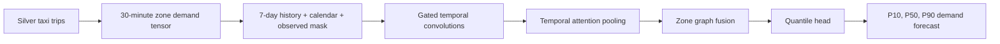
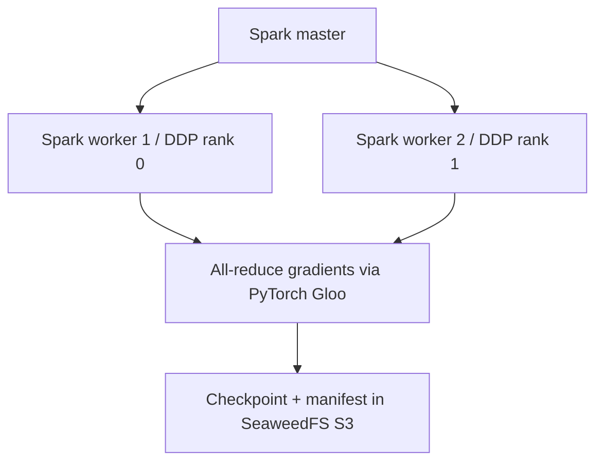

# UrbanFlow ML: Du Bao Nhu Cau Taxi Theo Zone

`urbanflow-ml` la phan thi nghiem Machine Learning cua UrbanFlow. Muc tieu la
du bao so luot taxi don tai tung NYC Taxi Zone trong **30 phut ke tiep**, dung
du lieu chuyen di da duoc lam sach o Silver va huan luyen phan tan bang Spark.

Du an nay chi ghi artifact vao `dev/ml/`; no **khong** thay doi Foundation
contract hay tao Gold contract moi. Ket qua hien tai la thuc nghiem, chua du
dieu kien de trien khai city-wide vi coverage du lieu nguon con thieu o thang
10 va 12 nam 2022.

## Bai toan va label

Tai thoi diem `t`, model du bao so chuyen duoc don tai zone `Z` trong khoang
`[t, t + 30 phut)`. Day la **supervised regression**, khong phai self-labelling
tuy tien: label la `trip_count`, so pickup thuc te tu NYC TLC Silver data.

- Input history: 336 bucket 30 phut truoc do = 7 ngay.
- Khong gian: 265 NYC Taxi Zone.
- Calendar features: sin/cos cua half-hour, weekday, month; weekend flag.
- `observed` mask: phan biet zero hop le cua zone trong bucket da quan sat voi
  khoang trong du lieu nguon.
- Time split: train `2022-08-08..2022-12-31`, validation
  `2023-01-01..2023-01-31`, test `2023-02-01..2023-02-28`.
- Warm-up bat dau `2022-08-01` de tao du 7 ngay lich su.

Tensor artifact duoc luu tai:

```text
s3a://urbanflow/dev/ml/runs/<run-id>/tensor/artifact.npz
```

Artifact chua counts, observed mask, calendar, zone IDs, fixed adjacency,
scaler va dataset fingerprint. Fingerprint ngan checkpoint cua dataset/cu hinh
khac bi resume nham.

## Core model: GTQN-Lite

**GTQN-Lite (Graph-Temporal Quantile Network - Lite) khong phai Transformer.**
Transformer dung multi-head self-attention giua token. GTQN-Lite dung temporal
convolution co gate, temporal attention pooling nhe, va graph message passing
giua cac zone. Lua chon nay phu hop CPU cluster nho hon Transformer day du va
phu hop demand forecasting.



### Cac khoi chinh

1. **Gated Temporal Convolution:** bon Conv1D layer co dilation `[1, 2, 4, 8]`
   hoc pattern ngan, trung va dai han. Moi layer dung gate, residual connection
   va GroupNorm. Day la temporal convolution, khong phai RNN.
2. **Temporal attention pooling:** hoc trong so cua cac thoi diem trong lich su
   7 ngay roi tong hop thanh state cho tung zone.
3. **Fixed OD graph:** graph co huong duoc tao tu luong `pickup_zone ->
   dropoff_zone` trong train period, co self-loop va row normalization.
4. **Adaptive graph:** chi o bien the `full`; hai zone embedding hoc adjacency
   matrix tu data, de bo sung lien he ma fixed OD graph bo sot.
5. **Graph gate:** ket hop temporal self-state va graph context bang sigmoid
   gate, khong bat graph luon chi phoi.
6. **Quantile head:** dua ra P10, P50 va P90. P50 la du bao trung tam; P10-P90
   the hien uncertainty.

Cau hinh hien tai dung `hidden_size=16`, `zone_embedding_size=16`, dropout
`0.2`, va khoang 17.8K parameters o bien the `full`.

## Ba bien the de so sanh khoa hoc

| Variant | Fixed OD graph | Adaptive graph | Cau hoi |
| --- | --- | --- | --- |
| `no_graph` | No | No | Temporal features mot minh co du khong? |
| `fixed_graph` | Yes | No | OD graph quan sat co giup khong? |
| `full` | Yes | Yes | Adaptive graph co them gia tri khong? |

Khong nen ep mot run da early-stop chay den epoch 60. So sanh ba bien the tren
cung split va metrics moi la bang chung tot hon ve gia tri cua graph.

## Distributed training



- **Spark TorchDistributor** tao 2 PyTorch process tren 2 Spark executor.
- **PyTorch DDP** chia batch deu cho rank 0 va rank 1. Gloo all-reduce gradient
  sau backward pass de ca hai worker co cung weights.
- **Rank evidence:** run ket thuc phai co du 2 ranks, 2 hostname khac nhau,
  batch duong va SHA-256 parameter checksum trung nhau de dat `PASS`.
- `fixed_graph` va `no_graph` dung `find_unused_parameters=True` vi co graph
  branch bi tat co chu dich.
- Spark master dung worker timeout 600 giay de tranh worker bi mat trong epoch
  CPU dai.

Checkpoint moi epoch:

```text
s3a://urbanflow/dev/ml/runs/<run-id>/training/<variant>/checkpoints/epoch-00001.pt
s3a://urbanflow/dev/ml/runs/<run-id>/training/<variant>/checkpoints/latest.json
```

Khi resume, config hash va dataset fingerprint phai trung truoc khi checkpoint
duoc nap. May tat hoac Docker restart se khong lam mat epoch da checkpoint.

## Ky thuat training va chong overfitting

| Ky thuat | Vai tro |
| --- | --- |
| Chronological split | Tranh data leakage tu tuong lai. |
| `log1p` + robust per-zone scaling | Giam chenh lech demand giua cac zone. |
| Quantile pinball loss | Hoc du bao P10/P50/P90 va uncertainty. |
| AdamW + weight decay `1e-4` | Regularization weights. |
| Dropout `0.2` | Giam overfitting. |
| Gradient clipping `1.0` | Han che gradient qua lon. |
| Gradient accumulation 4 steps | Batch hieu dung lon hon tren RAM CPU gioi han. |
| ReduceLROnPlateau | Giam learning rate khi validation khong cai thien. |
| Early stopping patience 8 | Tranh train qua muc. |
| Activation checkpointing + zone chunks | Doi compute lay memory thap hon tren CPU. |

## Metrics: danh gia dung cach

Day la regression, nen **khong dung classification accuracy**.

- **MAE:** sai so tuyet doi trung binh.
- **RMSE:** phat manh sai so lon o peak demand.
- **WAPE:** tong absolute error / tong demand that.
- **Signed bias:** du bao qua cao hay qua thap co he thong.
- **Pinball loss:** metric train/validation cho quantile.
- **Interval coverage:** ty le demand that nam trong P10-P90.
- **Top-k recall:** co bat dung zone demand cao nhat trong moi window khong.

Ket luan cuoi can test metrics, interval coverage, phan tich theo zone/borough,
va so sanh seasonal-naive va Spark MLlib GBT baseline.

## Quan sat run

Theo doi log real-time cua `fixed_graph`:

```powershell
Get-Content .\urbanflow-ml\output\training-logs\gtqn-gtqn-20260917-001-fixed_graph.log -Tail 50 -Wait
```

Hoac xem container hien tai:

```powershell
docker logs -f $(docker ps --filter "name=urbanflow-spark-submit" --format "{{.Names}}")
```

Spark UI: `http://localhost:8080`

Worker UI: `http://localhost:8081` va `http://localhost:8082`

## Hien trang thuc nghiem

- Run ID: `gtqn-20260917-001`.
- `full` da ket thuc sach tai epoch 10 boi early stopping; best validation
  quantile loss o epoch 2 la `0.0733497`.
- `fixed_graph` la run doi chung rieng; no bat dau tu epoch 1 va checkpoint tai
  prefix rieng. Thay epoch 5 trong Docker la binh thuong va **khong** co nghia
  `full` bi train lai.
- Dataset co sparse/incomplete source coverage o October va December 2022, nen
  ket qua hien tai dung cho hoc tap va thuc nghiem phan tan, chua du bang chung
  de van hanh du bao city-wide.

## Buoc tiep theo

1. Hoan thanh `fixed_graph`, sau do chay `no_graph` va Spark MLlib GBT baseline.
2. Danh gia test set bang MAE/RMSE/WAPE, pinball loss, interval coverage va
   top-k recall.
3. Chi ket luan adaptive graph huu ich neu `full` tot hon co y nghia so voi
   baseline tren test set, khong chi tren validation.
4. Bo sung du lieu day du truoc khi dua ket qua vao quyet dinh thuc te.
